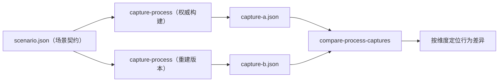

import { Meta } from '@storybook/addon-docs/blocks';

<Meta id="process-capture" title="原生二进制/动态分析/进程捕获" name="Docs" />

# 进程捕获

进程捕获（Process Capture）运行一条你指定的命令，把一次真实运行记录成一份**有界证据**：终端输出、计划交互、进程生命周期、选定文件系统状态。它的典型用法是同一场景跑两遍——权威构建一次、重建版本一次——再用比较命令逐维度定位行为差异。两个边界先说清：命令以当前用户权限运行、继承主机环境，REA **不是沙箱**，文件系统观察路径只决定快照拍哪里，不限制读写；它记录的是有界快照，**不是 syscall 跟踪**。需要函数级的参数与返回值观察时走 Frida 插桩（见 [Frida 插桩](?path=/docs/frida-instrumentation--docs) 一课），本课处理进程级的"行为快照与比较"。



| 入口 | 用途 | 关键点 |
| --- | --- | --- |
| `rea capture-process <scenario.json> --json > capture.json` | 运行一条命令并记录有界行为快照 | 证据走 `stdout`，进度走 `stderr`；仅 Linux/macOS 可捕获；输出文件不得与场景文件相同 |
| `rea compare-process-captures <a.json> <b.json> [trace.json]` | 比较两份同场景捕获，定位行为差异 | 契约不同的捕获被拒绝并指出差异字段；可执行文件与参数允许不同 |
| `scenario.json` | 声明运行什么、怎么交互、观察哪里 | 仅 `executable` 必需，其余字段有默认值（契约见 `processScenarioSchema`） |

## 快速上手

三步走完本课主线：写一份最小场景，捕获一次运行，看清输出和进度各走哪个流。

```json
// scenario.json —— 只有 executable 必需
{
  "executable": "node",
  "arguments": ["-e", "console.log('ready')"],
  "timeout_ms": 5000
}
```

```bash
# 捕获：证据重定向进文件，进度实时打在终端（stderr）
rea capture-process ./scenario.json --json > capture.json
```

`--json` 在保存 JSON 输出时必需——默认终端格式是 TOON。捕获期间 `stderr` 每行输出一个 JSON 进度对象，`phase` 依次是 `prepare` / `running` / `settling` / `cleanup`，最终 `cleanup` 行带 `terminal: true`，其 message 里的 `disposition=` 说明结束方式（`exited` / `timeout` / `idle_timeout` / `cancelled` / `failed`）；证据本身只写 `stdout`。

拿到 `capture.json` 后，换一个目标（比如重建版本）按同一场景再捕获一份，就能进入比较：`rea compare-process-captures capture-a.json capture-b.json`。

注意：重定向目标绝不能写成场景文件本身——重定向会先截断输出文件。

## 捕获一次运行

`capture-process` 的共同模型是：读一份场景 JSON，真实运行一次，产出一份证据 JSON。场景声明"跑什么、怎么交互、拍哪里、给多少预算"，证据记录"实际发生了什么"。

### 场景文件

完整场景长这样（各字段都有默认值，按需出现）：

```json
{
  "executable": "node",
  "arguments": ["./signup.mjs"],
  "working_directory": ".",
  "environment": { "APP_MODE": "test" },
  "filesystem_observation_paths": ["./state"],
  "terminal": { "columns": 80, "rows": 24, "scrollback": 1000 },
  "events": [
    { "type": "input", "at_ms": 250, "data": "user@example.test\r", "sensitive": true },
    { "type": "resize", "at_ms": 500, "columns": 100, "rows": 30 },
    { "type": "signal", "at_ms": 1000, "signal": "SIGINT" }
  ],
  "timeout_ms": 30000,
  "idle_timeout_ms": 30000,
  "settle_ms": 100
}
```

| 字段 | 作用 | 约束与回查要点 |
| --- | --- | --- |
| `executable` | 要运行的命令 | 唯一必需字段 |
| `arguments` | 命令参数数组 | 比较时允许与对方不同 |
| `working_directory` | 工作目录 | 比较时两次运行须为相同绝对路径 |
| `environment` | 显式环境变量覆盖 | 覆盖值进证据；继承值不记录 |
| `filesystem_observation_paths` | 快照观察的文件系统路径 | 比较时须一致；只决定拍哪里，不限制读写 |
| `terminal` | `columns` / `rows` / `scrollback` | `columns × (rows + scrollback) ≤ 1,000,000` |
| `events` | 计划交互脚本 | 时间有序、须在 `timeout_ms` 内 |
| `timeout_ms` / `idle_timeout_ms` / `settle_ms` | 总超时、空闲超时、静置等待 | 有默认值，精确契约见 `processScenarioSchema` |
| `finalization_ms` | 优雅收尾窗口 | 默认 `0`：超时直接 SIGKILL |
| `normalization` | 归一化规则 | 见归一化一节 |
| `limits` | `output_bytes` 限定终端内容，`file_bytes` 是文件哈希预算 | 见捕获内容与截断 |

环境只记录你显式覆盖的值——证据里是"你声明的差异"，继承自主机的环境不进入证据。

### 计划交互

`events` 让捕获可以"照剧本运行"：`input` 模拟键盘输入、`resize` 调整终端尺寸、`signal` 发送信号。`at_ms` 是启动后的毫秒数，事件必须按时间有序，且都要落在 `timeout_ms` 之内。

`input` 事件可标 `sensitive: true`：输入照常发给进程，但证据里只持久化为字节计数的占位符——口令发得出去、留不下来。

### 捕获内容与截断

一份捕获记录：原始 PTY 输出块、渲染后的终端状态、交互分发结果、退出原因（`exit`）、进程树采样、settlement 状态；给了 `filesystem_observation_paths` 时还会记录 `files_before` / `files_after`，并分类为 `created` / `deleted` / `modified` / `unchanged`。

终端帧的关键字段：`data` 是归一化后的比较文本，`raw_data` 是归一化改变文本时的原文（读原文用 `raw_data ?? data`）；`lines` 是去掉尾部空格的可见行，`serialized_state` 是序列化状态，`columns` 是单元格宽度。

收尾分两档：默认超时到点直接 SIGKILL；设了 `finalization_ms` 则先 SIGTERM 并继续捕获，超过宽限才 SIGKILL（取消仍立即 SIGKILL）。所有 deadline 退出的 `exit.code` 一律为 `null`，finalization 期间的退出码在 `exit.finalization.exit_code`，发出的信号列在 `exit.finalization.signals`（`delivery` 取 `signaled` / `gone` / `identity-changed` / `unverified`）。

截断是常态机制，不是异常：`limits.output_bytes` 限定终端内容，`limits.file_bytes` 是跨所有根的累计哈希预算（每个检查点重新分配）。预算不足时产生 `null` 摘要加明确的省略原因，绝不拿部分哈希冒充完整摘要；省略了什么在**必需字段** `truncation_details` 里逐项说明——`raw_terminal` / `normalized_terminal` / `rendered_terminal` / `filesystem_before` / `filesystem_after` / `process`，含枚举失败、未哈希原因（`file_bytes_budget` / `file_changed_or_short_read` / `file_unavailable`）与采样失败。文件哈希用 SHA-256，出现在 `normalized_result.files_after`；文件按 64 KiB 块读取哈希，内容本身不嵌入证据。缺 `truncation_details` 的捕获在导入时会被拒绝。

## 归一化

比较的前提是两次运行"可同框"。`normalization` 提供两类规则：

- **`patterns`**：字面替换，支持 `$&`（整段匹配）与 `$$`（转义 `$`）；注意空模式也会匹配文本的首尾位置。配置会提交 `pattern_normalization_version: "literal-replacements-v1"`，归一化版本不同的两次捕获比较会被拒绝。
- **端口归一化**：识别 `port` / `tcp_port` / `udp_port` / `listen` 字段、URL authority、IP/localhost 端点（0–65535），每个输出块独立归一化；`ports: false` 保留端口号原样。

典型用法：时间戳、随机 ID、每次监听端口都不同的输出，先用 `patterns` 抹平再比较，否则真差异被运行噪声淹没。

## 比较两次捕获

```bash
rea compare-process-captures authority.json reconstruction.json
```

比较建立在**契约**上：两份捕获必须在工作目录（相同绝对路径）、显式环境、观察路径、终端尺寸、脚本事件、超时、限制、归一化上一致；**可执行文件与参数允许不同**——这正是"权威构建 vs 重建"的标准用法。契约不一致时比较被拒绝，并指出差异字段，不会强行比下去。

契约通过后，差异按维度报告观测到的不同及其位置（terminal、interaction、exit、filesystem、process）。捕获不完整时无法跨所有维度定位首次分歧：受影响维度标记为 `unknown`，未受影响维度保留各自结果。

第三个可选参数是 trace-specification JSON，声明确切的事件与顺序约束。三条边界：它不丢弃未匹配的观测；时间戳不构成因果证据；捕获缺少完整事件日志或存在相关未知时返回 `unknown`。

## 平台与限制

- **可捕获的平台**：Linux 或 macOS，且 PTY 后端可用。Windows 原生捕获不可用（PTY 适配器尚未验证后代进程清理）；比较已有证据不受平台限制。Linux 命令可在 WSL 内运行，在 Windows 侧重装 PTY 二进制无效。
- **PTY 二进制缺失**：按平台/架构/Node 版本匹配，启用可选依赖重装 REA。
- **macOS 准备**：进程所有权检查助手需要经 `xcrun` 的 Swift 编译器编译（REA 编译到私有临时目录并在退出时删除，capability 检查会预先准备）。沙箱环境需放行 setuid 的 `/bin/ps`，否则 `spawn EPERM` 导致 `cleanup_incomplete`。需要绕开 `xcrun` 查找时用 `REA_DARWIN_MODULE_CACHE_PATH`，或配对设置 `REA_DARWIN_SWIFTC_PATH` 与 `SDKROOT`（均须绝对路径）。
- **数值约束**：`columns × (rows + scrollback) ≤ 1,000,000`（resize 同样受限，超限在启动前拒绝，从不钳位）；`timeout_ms + finalization_ms + settle_ms ≤ Number.MAX_SAFE_INTEGER`。
- **清理失败**：保留资源供重试，所有 owner 确认释放后清除 `cleanup_incomplete`；主机扣留了无关进程的运行 token 时，REA 不触碰它们，只记录进 `cleanup.unverified_processes`。

## 最佳实践

- **先冻结契约，再做两次捕获**：打算比较，就先固定 `working_directory`、观察路径、终端尺寸、事件脚本、超时与归一化，只留 `executable` / `arguments` 的替换空间；任何契约字段漂移都会让比较直接被拒。
- **观察路径收窄到写动点**：`filesystem_observation_paths` 只列场景真正写入的目录，证据更聚焦，`file_bytes` 哈希预算也更省。
- **敏感输入一律 `sensitive: true`**：口令、令牌类交互照常驱动进程，证据里只留字节计数，比较按占位符对齐。
- **先读 `truncation_details` 再下结论**：看到 `null` 摘要或 `truncated` 标志时，先查省略原因（预算不够、文件变动还是读取失败），确认缺失部分不影响你关心的维度。

## 常见问题

- 跑完发现 `capture.json` 是空的，`scenario.json` 也不见了？
  输出重定向到了场景文件本身——重定向会先截断目标文件。输出路径必须与场景输入不同，场景文件用版本控制或备份兜底。
- 超时结束的捕获里 `exit.code` 是 `null`，进程明明有退出码？
  约定如此：所有 deadline 退出（`timeout` / `idle_timeout`）的 `exit.code` 一律为 `null`。finalization 期间实际拿到的退出码看 `exit.finalization.exit_code`。
- Windows 上 `capture-process` 直接不可用？
  平台边界，不是安装坏了：Windows 原生捕获不可用（PTY 适配器尚未验证后代清理）。捕获放到 Linux/macOS 或 WSL 里做；Windows 侧仍可比较已有证据。
- 报 PTY 后端缺失？
  可选依赖没装全：匹配当前平台/架构/Node 版本，启用可选依赖重装 REA；换 Node 大版本后同理。
- macOS 上报 `spawn EPERM`，结果带 `cleanup_incomplete`？
  进程所有权检查要调用 setuid 的 `/bin/ps`，沙箱需放行它。另外注意改写 `process.title`（npm 运行时也会改）可能让运行 token 不可读，收尾退化为 `unverified` 记录。

## 总结回顾

摘要：

进程捕获把"跑一次命令"变成一份有界证据：场景 JSON 声明运行什么、怎么交互、观察哪里、给多少预算，仅 `executable` 必需；`capture-process` 在 Linux/macOS 上真实运行并产出证据——终端输出与渲染状态、计划交互的分发结果、退出原因、进程树采样、观察路径的 before/after 文件分类。截断是常态机制，省略台账集中在必需字段 `truncation_details`。归一化把每次运行必然不同的噪声（时间戳、随机 ID、端口）抹平，并绑定版本防止跨规则比较；`compare-process-captures` 在相同契约下逐维度定位两份捕获的差异，可执行文件与参数不同而其余一致，正是"权威构建 vs 重建"的标准用法。

一句话：

> 捕获回答"它做了什么"，比较回答"两次运行差在哪"——契约一致才有可比性，`truncation_details` 是证据边界。

知识要点：

- `capture-process` 的输入输出各走哪个流，`--json` 什么时候必需，进度行的 `phase` 和 `disposition=` 怎么读？
- 场景文件哪些字段必需？`events` 支持哪三类交互，`sensitive: true` 的输入在证据里变成什么？
- 一份捕获包含哪些内容？文件差异如何分类？`truncation_details` 为什么必需、预算不足时摘要长什么样？
- deadline 退出后去哪找真实退出码？`finalization_ms` 改变了什么收尾行为？
- 归一化有哪两类规则？为什么归一化版本不同的捕获不能比较？
- `compare-process-captures` 的契约里哪些字段必须一致、哪些允许不同？第三参数 trace specification 有哪三条边界？
- 哪些平台能捕获、Windows 上能做什么？macOS 需要哪些额外准备？

## 参考资料

- [Process capture（docs/process-capture.md）](https://raw.githubusercontent.com/morluto/rea/main/docs/process-capture.md)
  本课主文档：场景契约、捕获内容、归一化与比较契约、finalization、truncation_details 与平台限制。
- [REA CLI guide（docs/cli.md）](https://raw.githubusercontent.com/morluto/rea/main/docs/cli.md)
  `capture-process` / `compare-process-captures` 的命令归类、取消退出码（SIGINT 130 / SIGTERM 143）与全局输出规则。
