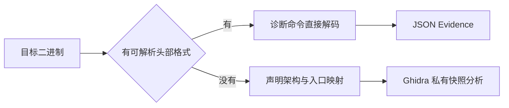

import { Meta } from '@storybook/addon-docs/blocks';

<Meta id="raw-binary-diagnostics" title="原生二进制/静态调查/原始二进制与诊断" name="Docs" />

# 原始二进制与诊断

Ghidra、IDA、Hopper 打开目标的前提，是文件自带可解析的头部格式。本课处理两类绕不开这个前提的目标：文件本身就是无头裸字节——固件镜像、从设备提取的代码段；以及文件有标准格式，但你想在启动重型引擎之前先摸清内部布局。两条路径共用同一条纪律：REA 不猜。raw-binary 把"这是什么 CPU、从哪个地址执行"完全交给你显式声明；诊断命令只解码你指定的文件，解不了的地方显式报错或显式标注未知，从不静默编造。崩溃记录分析是独立主题，入口在崩溃记录一课，本课不展开。



| 命令 | 目标 | 前置 | 回答的问题 |
| --- | --- | --- | --- |
| `rea inspect` | 无头二进制 | 架构 + 入口 + `--provider ghidra` | 按声明映射能否打开，返回规范化 `entry_point` 供核对 |
| `rea function` | 无头二进制 | 同上 | 指定入口函数的分析与反编译 |
| `rea inspect-native-load-image` | 无头二进制 | 同上 | 加载映像独立验证：流式输出快照 digest 与范围 |
| `rea inspect-binary-layout` | ELF64 x86-64 | 自带隔离 Python（pwntools / pyelftools / Unicorn） | 节/段布局、符号、重定位、依赖、缓解指标 |
| `rea inspect-analysis-view` | 已保留的布局 Evidence | inline JSON 或 `evidence_id` | 从存档投影摘要、切面、单节/单符号或分页 |
| `rea inspect-pe-resources` | PE32/PE32+ | 无引擎、无 Python、无 Windows SDK | 类型/名称/语言三级资源树与载荷清单 |

## 快速上手

两条路径各跑一条命令。第一条把无头镜像显式映射进 Ghidra，前提是 ghidra provider 已就绪；第二条离线解码标准 ELF，不需要活跃的分析引擎，但需要一个环境里已含未改动 pwntools 4.15.0、pyelftools 0.33 与 Unicorn 2.1.2 的绝对路径 Python。

```bash
# 1) 无头文件：架构 + 入口 + raw-binary 格式，缺一不可
rea inspect /absolute/path/to/ecu.bin --target-format raw-binary --architecture arm --entry-point 0x8000000 --provider ghidra --json

# 2) 标准格式：离线解码 ELF 布局
REA_PWNTOOLS_PYTHON=/absolute/isolated-env/bin/python \
  rea inspect-binary-layout ./selected.elf --json
```

两次调用都返回结构化结果：被观察字节用路径、字节数与 SHA-256 标识，解析读自有稳定快照，原文件保持不变；raw-binary 一侧还会回传规范化的 `entry_point`，供你直接核对 Ghidra 实际采用的映射。其余小节展开每条路径能回答什么、不能回答什么。

## 原始二进制

raw-binary 不是一个能被识别出来的文件格式，而是一个显式声明：从偏移 0 起的完整字节就是某个 CPU 家族的指令与数据，没有头部可供解析。这层解释完全来自调用方，REA 不从 `.bin` 后缀或无法识别的字节推断它。打开时整个文件从偏移 0 映射到你声明的入口地址，Ghidra 在自动分析前在该地址预置 `entry` 函数。

`--architecture` 的全部取值与对应语言设置：

| 取值 | language_id | compiler_spec_id | 字节序 | 入口对齐 |
| --- | --- | --- | --- | --- |
| `x86` | `x86:LE:32:default` | `gcc` | 小端 | 任意 |
| `x86_64` | `x86:LE:64:default` | `gcc` | 小端 | 任意 |
| `arm` | `ARM:LE:32:v7` | `default` | 小端 | 4 字节 |
| `arm64` | `AARCH64:LE:64:v8A` | `default` | 小端 | 4 字节 |
| `6502` | `6502:LE:16:default` | `default` | 小端 | 任意 |
| `m68k` | `68000:BE:32:default` | `default` | 大端 | 2 字节 |

表外四条边界：

- `--entry-point` 是 `0x…` 形式的十六进制地址。6502 的入口与完整映射必须落在 `0x0000..0xffff`，跨 16 位边界的镜像在 provider 启动前被拒；m68k 的映射必须落在 `0x0..0xffffffff`。
- compiler spec 只选择分析约定，不标识无头目标真实的编译器或 ABI，寄存器与调用约定同理。Ghidra 的 x86 语言没有名为 `default` 的编译器规范，所以 x86 家族写 `gcc`。
- 省略 `format` 时保持头部检测；只给架构与入口而不带 `format=raw-binary` 会被直接拒绝。
- 语言设置、调用方入口与 `language_selection: caller-supplied-v1` 一起写入分析 profile：入口或架构不同就是不同 profile，头部检测打开的目标快照不可重放。

### 打开与分析

三个命令共用同一组声明参数，引擎固定选 `--provider ghidra`（Hopper 与 IDA 拒绝 raw-binary 目标）：

```bash
rea inspect /absolute/path/to/ecu.bin --target-format raw-binary --architecture arm --entry-point 0x8000000 --provider ghidra --json
rea function /absolute/path/to/ecu.bin 0x8000000 --target-format raw-binary --architecture arm --entry-point 0x8000000 --provider ghidra --json
rea inspect-native-load-image /absolute/path/to/ecu.bin --target-format raw-binary --architecture arm --entry-point 0x8000000 --provider ghidra --json
```

MCP 侧等价调用是 `open_binary`：

```json
{
  "name": "open_binary",
  "arguments": {
    "path": "/absolute/path/to/ecu.bin",
    "format": "raw-binary",
    "architecture": "arm",
    "entry_point": "0x8000000",
    "provider_id": "ghidra"
  }
}
```

三个命令各回答一个问题：

- `inspect` 打开并检查目标。`open_binary` 与打开的 `binary_session` 会返回规范化的 `entry_point`，直接核对所选映射。
- `function` 分析并反编译指定入口处的函数。
- `inspect-native-load-image` 独立验证加载映像：以受限内存流式输出完整私有快照的 digest 与范围，读取期间可取消。它要求源代码块在绑定语言的默认地址空间中已初始化、已加载且非 overlay；相互矛盾的映射观察即使源哈希一致，也以 `mismatch` 保留。

三个映射细节值得记录：BinaryLoader 的程序镜像基址保持 `0x0`，与映射起点无关；Ghidra 可能报告额外的语言定义入口（含未映射的 ARM 向量），它们作为观察保留；加载映像验证要求调用方入口，并把这些额外入口原样保存。

### 6502 通道

只接纳入口已知、入口代码就在文件偏移 0 的无头 NMOS 6502 代码。内置 Ghidra 处理器提供静态指令、函数、伪代码与引用；Evidence 保留 `architecture: "6502"`、所选语言、入口、文件摘要与已验证的源映射。

```bash
rea function /absolute/path/to/image.bin 0x8001 --target-format raw-binary --architecture 6502 --entry-point 0x8001 --provider ghidra --json
rea inspect-native-load-image /absolute/path/to/image.bin --target-format raw-binary --architecture 6502 --entry-point 0x8001 --provider ghidra --json
```

映射顺序：BinaryLoader 先映射文件，再叠加语言定义的零页与栈块。冲突的默认块被跳过；低地址文件留在默认地址空间而非 overlay；无冲突的未初始化块只是观察，不是文件字节。

通道边界：不解释 iNES 头、卡带 mapper、bank switching 或其他主机专属内存布局；65C02 与 65816 需要不同处理器语义，不会按对应变体接纳；REA 不从后缀推断 CPU、不猜复位向量、不模拟目标。

仓库验证脚本 `npm run verify:ghidra:6502` 用 `ca65` 与 `ld65`（cc65 tag `V2.19`，工具自报 `V2.18`）汇编并链接自有 fixture，可用 `REA_CA65`、`REA_LD65` 指定可执行文件路径。通道核查 CLI/MCP 加载映像平价、映射字节、解码调用、反编译、非法映射、源字节不变与运行时清理；低内存检查覆盖横跨零页/栈边界（`0xff`）的文件与完整 64 KiB 镜像（`0x0`）。

### m68k 通道

只接纳入口已知、为偶数、入口代码就在文件偏移 0 的无头大端 68000 族代码。Ghidra 的 `68000:BE:32:default` 语言在 32 位 `ram` 地址空间解码 68040 超集：真实 MC68000 不会执行的指令不会被拒绝，68020、68030、CPU32 与 ColdFire 程序不会按对应变体接纳，地址也不会掩码到 MC68000 的 24 位总线。Evidence 保留 `architecture: "m68k"`、所选语言、入口、文件摘要与已验证的源映射。

```bash
rea function /absolute/path/to/image.bin 0x1000 --target-format raw-binary --architecture m68k --entry-point 0x1000 --provider ghidra --json
rea inspect-native-load-image /absolute/path/to/image.bin --target-format raw-binary --architecture m68k --entry-point 0x1000 --provider ghidra --json
```

通道边界：不解释 Amiga hunks、Atari ST 或其他容器头，也不读前 8 字节里的初始栈指针与复位向量——入口必须显式给出。Windows Ghidra P0 不接纳 m68k。

仓库验证脚本 `npm run verify:ghidra:m68k` 使用验证器内以注释十六进制写成的 22 字节自有 fixture，无需汇编器。通道核查 CLI/MCP 加载映像平价、映射字节、按地址与文件偏移的反编译、未对齐与越界映射、源字节不变与运行时清理。已在 macOS 用 Ghidra 12.1.4 跑通；Linux 未验证。

### 平台与能力边界

平台准入：Hopper 与 IDA 拒绝 raw-binary 目标。Windows Ghidra P0 只接纳原生 PE 应用/DLL 与显式选择的 raw 6502 镜像，其他 raw CPU 家族（含 m68k）都在 Windows 边界之外。原生路径准入、私有 DACL、Job Object 所有权、不可变快照与不变更策略照常适用。

官方限制清单：

- 不从头字节发现头部；加载地址、向量表、内存映射都不猜。
- 大端 ARM、Thumb-only、Cortex-M 等 Ghidra 处理器变体不支持；m68k 是唯一大端家族。
- 复位向量、内存映射 I/O 与固件启动序列不模拟。
- 独立加载映像验证覆盖源身份、映射文件字节、绑定语言与调用方入口；原始字节保持不变。

## 二进制诊断

诊断命令回答另一个问题：你指定的文件里到底有什么。`inspect-binary-layout` 解码 ELF 的节/段布局、原始符号与重定位、静态链接名与缓解指标；`inspect-pe-resources` 检查 PE 资源树。两者都不需要活跃的 Hopper、Ghidra 或 IDA 目标——CTF、崩溃分诊、兼容性检查与普通二进制检查共用同一套模块化能力。

共同纪律：REA 不安装 Python、包或 GDB，不改用户初始化文件，不把目标当宿主进程启动，也不请求运行时库解析；Python 进程以隔离模式与自有缓存运行；所有解析读自有稳定快照，原文件不变。边界：核心转储、GDB 会话/状态/控制、pwndbg 增强与指令检查是独立增量（issue #969），本课不声明支持；崩溃记录的完整分析见崩溃记录一课。

### ELF 布局 inspect-binary-layout

初期真实验证覆盖 **Linux x64 的 ELF64 x86-64 小端 EXEC/DYN/REL**，对其他操作系统与架构不做真实支持声明。解码靠自带引擎——一个环境里已含未改动 pwntools 4.15.0、pyelftools 0.33 与 Unicorn 2.1.2 的绝对路径 Python，上游精确画像记录在 [third_party/pwntools 的 README](https://github.com/morluto/rea/blob/main/third_party/pwntools/README.md)：

```sh
REA_PWNTOOLS_PYTHON=/absolute/isolated-env/bin/python \
  rea inspect-binary-layout ./selected.elf --json
```

MCP 侧等价调用：

```json
{
  "name": "inspect_binary_layout",
  "arguments": { "path": "/artifacts/selected.elf" }
}
```

完整结果的预算：

| 预算 | 值 |
| --- | --- |
| 输入文件 | 32 MiB（`REA_PWNTOOLS_MAX_INPUT_BYTES` 只放开输入，最高 1 GiB） |
| 回复 | 64 MiB，约束解码记录；CLI/MCP Evidence 信封另加拷贝与编码开销 |
| 诊断合计 | 1 MiB |
| 命令期限 | 30 秒 |
| Python 软限制 | 至多 3 GiB 虚拟地址空间、30 CPU 秒、64 MiB 文件输出 |

所有限制超限一律失败、没有部分成功，REA 不静默截断；继承的更紧限制被保留，生效值写进结果的 limitations。虚拟地址空间不是 RSS，Unicorn 需要大虚拟映射。MCP SDK 默认 10 MiB 接收缓冲，大型完整结果需要调用方配置 `StdioClientTransport({ maxBufferSize: ... })` 并匹配服务端 `REA_MCP_MAX_RESPONSE_BYTES`；大扩展索引验证在独立 opt-in MCP 通道里用 256 MiB 与显式 5 分钟请求超时。

读数规则（回查表）：

| 读数 | 规则 |
| --- | --- |
| 地址、偏移、长度、标志 | 十六进制字符串；链接地址不是运行时地址，runtime load base 保持 null |
| entry | 零值 EXEC/DYN entry 表示缺失；可重定位目标的 entry 不适用 |
| 符号值 | 可能是 undefined、对齐、绝对值、无地址、未知节索引、节内偏移、TLS 偏移或链接虚拟地址；重名保留为独立条目 |
| REL/RELA 加数 | 有符号十进制字符串 |
| RELR | 保留完整原始字节与上游解码偏移（派生证据）；隐式加数未知，整体重定位清单完整性未知 |
| 动态依赖与解释器 | `DT_NEEDED` / `PT_INTERP` 是报告的名字，不是解析后的运行时路径 |
| GOT/PLT | 派生便利视图，可能合并别名；PLT 推断在 Unicorn 模拟选定指令，输出是静态候选 |
| 缓解指标 | canary、PIE、NX、可执行栈、RELRO 全是静态推断；NX 与可执行栈相互独立，x86-64 上可执行栈可伴随未知的 null NX；`ET_DYN` 可能只是共享库；缺 canary 符号不证明所有函数无保护 |

显式未知与失败：

- `SHN_XINDEX` 不静默解析，外部索引表不会被当作已解析处理。
- 可重定位的 `SHN_UNDEF` 目标与非活动 `SHT_NULL` 头保持显式未知，保留原节索引与偏移。
- 节名与符号表要求声明的 `SHT_STRTAB` 链接，名字偏移与终止符必须留在声明的字符串表内；畸形引用在"无关字节变成名字"之前失败，并带出受影响的节与符号索引。`SHN_UNDEF` 显式表示无节名：显示为空，原始名字与位置未知，原名字偏移保留。
- 动态依赖用 `DT_STRTAB` / `DT_STRSZ`，要求唯一且基于文件的映射；歧义或无支撑映射显式不支持。动态标签要求 `PT_DYNAMIC` 内有完整的 `DT_NULL`。
- `NOBITS`、`NULL` 与零文件大小段没有文件字节；`PT_NULL` 的解释权限为 null、文件后备为 none，报告的数字保留。
- 无节动态镜像仍报告能唯一映射的依赖名（原始字节与文件位置）；缺符号/重定位表不证明运行时表不存在；RELRO/canary 启发式依赖节，此时可能不完整，候选带显式覆盖限制。
- 类型化解码失败保留有界 `captured_output`（stdout、stderr 与显式截断标志）和原失败类别与原因；成功结果的 `diagnostics` 暴露 supervisor 的 `truncated` 标志。
- 内存分配失败归 `resource_constraint`，带生效限制（或显式未知）与内存专项恢复建议；`MemoryError` 本身不证明具体哪笔分配失败；信号终止本身从不算已观察的内存耗尽；`SIGXCPU` 与 `EFBIG` / `SIGXFSZ` 各有专项诊断与恢复建议。

### 视图投影 inspect-analysis-view

完整布局 Evidence 已经保留时，`inspect-analysis-view` 从存档投影视图——摘要、缓解或链接（linkage）切面、单个节或符号、或一个稳定分页——不重跑解码器。CLI 一次性调用传可移植的 inline Evidence JSON；MCP 会话用保留的 `evidence_id`。分页 `limit` 必需，受 MCP stdio 预算约束。

MCP 侧还有一条轻量路径：`inspect_binary_layout` 带 `"detail": "summary"` 时，完整布局 Evidence 留在会话里，只返回摘要视图；`normalized_result.parent_evidence_id` 指认保留的布局记录，供后续节、符号、缓解或链接视图引用。默认 `complete` 与 CLI 输出不受影响。

### PE 资源 inspect-pe-resources

`inspect-pe-resources` 检查显式 PE32/PE32+ 文件的资源树，不需要活跃目标、原生引擎、Python 或 Windows SDK：

```sh
rea inspect-pe-resources ./selected.exe --json
```

```json
{
  "name": "inspect_pe_resources",
  "arguments": { "path": "/artifacts/selected.exe" }
}
```

完整 Evidence 以路径、字节数与 SHA-256 标识稳定快照。资源保留类型、名称、语言三层身份：数字 ID 与 UTF-16 名字相互独立，名字的原始字节一并报告；目录头、目录项、数据项与载荷保留原始文件偏移与长度；每个不透明载荷有自己的 SHA-256，code page 与保留的数据项字段原样保留。

`RT_GROUP_ICON` 记录暴露原始图标描述与 `RT_ICON` 候选；只有存在同数字 ID 同语言的图标时引用才解析。缺失引用、异语言候选、声明尺寸不匹配都保持显式。编码尺寸原样保留（0 表示 256 像素）。这是静态引用检查：不做图像解码、语言回退、资源加载，也不执行所选文件。

预算与边界：

| 项 | 默认 | 上限 |
| --- | --- | --- |
| `--max-file-bytes` | 64 MiB | 512 MiB |
| `--max-entries` | 16384 | 65536 |
| 元数据 | — | 8 MiB |

超任何预算即失败，不截断。资源数据目录缺失是完整的空清单。畸形头、截断表、环、重复兄弟 ID、无支撑或歧义 RVA 映射、非等同重叠范围、不支持的树形状一律显式失败，不返回部分清单。支持的树固定三层：类型、名称、语言；其他资源载荷格式保持不透明。只读常规文件，拒绝符号链接；快照读取、目录遍历与载荷哈希期间可取消。

## 最佳实践

- **标准格式先诊断，再上引擎。** `inspect-binary-layout` 与 `inspect-pe-resources` 不需要活跃目标，先用它们拿到节/段、符号、依赖与缓解指标，决定用哪个 provider、从哪里下钻，再让 Ghidra、IDA 或 Hopper 做重分析。
- **raw-binary 的参数必须有出处。** 架构与入口只能来自芯片手册、链接脚本、引导代码等可靠来源，REA 不会替你猜；参数一变就是新的分析 profile，把映射决定记进分析笔记才可复现。
- **大结果先留存，再投影。** MCP 会话用 `"detail": "summary"` 留完整 Evidence、正文只回摘要；CLI 把完整输出存文件后用 `inspect-analysis-view` 投影。确需传递完整结果时，同步调大调用方 `StdioClientTransport` 接收缓冲与服务端 `REA_MCP_MAX_RESPONSE_BYTES`。

## 常见问题

- 给了 `--architecture` 和 `--entry-point`，命令还是被拒？
  补上 `--target-format raw-binary`。省略 `format` 时保持头部检测，只给架构与入口而不带 `format=raw-binary` 会被直接拒绝——REA 不从 `.bin` 后缀或无法识别的字节推断格式。
- ELF 报告里的地址能直接当运行时地址用吗？
  不能。链接地址不是运行时地址，runtime load base 保持 null；`ET_DYN` 可能只是共享库；零值 EXEC/DYN entry 表示缺失。真实加载基址要靠运行时观测确认。
- 缓解指标显示缺失，能断定二进制没防护吗？
  不能反向断定。这些指标是静态推断：无节动态镜像下 RELRO/canary 启发式可能不完整；缺 canary 符号不证明每个函数都无保护；x86-64 上可执行栈可与未知的 null NX 并存。把指标当线索，把结论交给验证。
- 目标是 stripped 的，诊断还能给出什么？
  节表缺失时仍报告能唯一映射的动态依赖名与解释器路径（原始字节与文件位置）。反过来也要注意：缺符号/重定位表不证明运行时的表不存在。
- 结果很大，会被悄悄截断吗？
  不会。任何预算超限都整体失败，不返回部分结果；成功结果的 `diagnostics` 带 `truncated` 标志。输入上限 32 MiB 可用 `REA_PWNTOOLS_MAX_INPUT_BYTES` 提到 1 GiB；MCP 大结果还要调接收缓冲。
- Ghidra 启动失败，怀疑是内存不够？
  失败输出中出现 `java.lang.OutOfMemoryError` 时归类 `resource_constraint` 并附堆专项恢复建议；metaspace 与数组尺寸失败不建议加堆，native 线程耗尽按容量约束报告。注意 `configured_jvm_max_heap` 只是启动器选定的 `-Xmx` 配置事实，不是实测用量；输出不完整本身也不能确认内存原因。

## 总结回顾

摘要：

本课覆盖两条不依赖"文件自带格式"假设的分析路径。raw-binary 路径把解释权交给你：架构、入口与 `format=raw-binary` 三个输入缺一不可，整个文件从偏移 0 映射到入口地址，Ghidra 在入口预置 `entry` 函数；六种架构各有固定语言与字节序，入口对齐与地址范围各有限制，6502 与 m68k 两个通道的接纳条件与边界都写得很死。诊断路径在分析引擎之外直接解码显式文件：`inspect-binary-layout` 借自带 Python 报告 ELF 的节/段、符号、重定位、依赖与缓解指标，`inspect-pe-resources` 内置解码 PE 资源树，`inspect-analysis-view` 从已保留的布局 Evidence 投影小视图。两条路径共享同一条纪律：不猜、不静默截断，解不了的显式报错或显式标注未知。

一句话：

> 没有格式就显式声明映射，有格式就先离线摸底——REA 只解释你声明的内容，不确定的地方都会明说。

知识要点：

- raw-binary 的三个必需输入是什么？省略 `format` 或只给架构与入口会发生什么？
- 六种架构的语言、字节序与入口对齐是什么？6502 与 m68k 的地址范围约束是什么？
- `inspect`、`function`、`inspect-native-load-image` 各回答什么问题，`entry_point` 核对怎么做？
- `inspect-binary-layout` 的环境要求与输入/回复/诊断预算是什么，读数规则里哪些是显式未知？
- `"detail": "summary"` 与 `inspect-analysis-view` 分别怎么从完整布局 Evidence 得到小视图？
- `inspect-pe-resources` 输出什么、默认与最大预算是多少、哪些畸形会显式失败？

## 参考资料

- [Headerless raw-binary analysis with Ghidra（docs/raw-binary.md）](https://raw.githubusercontent.com/morluto/rea/main/docs/raw-binary.md)
  raw-binary 主文档：架构与语言表、对齐与地址范围、6502 与 m68k 通道、平台边界与官方限制清单。
- [Offline binary diagnostics（docs/binary-diagnostics.md）](https://raw.githubusercontent.com/morluto/rea/main/docs/binary-diagnostics.md)
  诊断主文档：ELF 布局解码与读数规则、显式未知与失败分类、投影视图、PE 资源与预算、Ghidra OOM 分类。
- [MCP contracts（docs/mcp-contracts.md）](https://raw.githubusercontent.com/morluto/rea/main/docs/mcp-contracts.md)
  MCP 传输预算（`StdioClientTransport` 接收缓冲与 `REA_MCP_MAX_RESPONSE_BYTES`）的权威出处。
