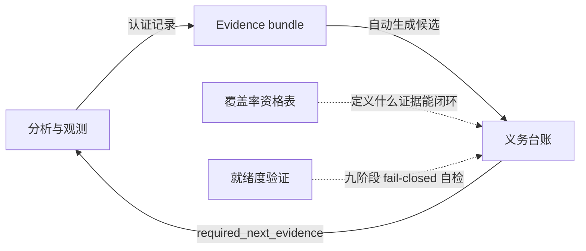

import { Meta } from '@storybook/addon-docs/blocks';

<Meta id="reconstruction-workflow" title="Evidence 与重建/重建工作流" name="Docs" />

# 重建工作流

REA 的功能重建不是一条命令,而是一条由 Evidence 驱动的工作流:分析会话产出认证过的 Evidence 记录;义务台账把记录变成一份确定性的重建 claim 清单,并标注每条还缺什么;覆盖率评估判定某个边界的验收结论有没有资格合格的证据;就绪度验证在仓库层端到端检查这条链本身是否 fail-closed。三者回答同一个闭环问题的三个侧面——要证明什么(台账)、证据够不够格(覆盖率)、流程可不可信(就绪度)。

本课是三个概念的家族课:先看整体怎么组织,再逐个讲各自的入口、语义与推进方式。具体目标(例如某个 JS 应用)的源码恢复与构件重建由源码恢复与重建一课承载;Evidence 包的导入导出与比较见 Evidence 包管理一课。本课只管工作流本身。



| 概念 | 回答的问题 | 入口 | 产出 |
| --- | --- | --- | --- |
| 义务台账 | 要证明哪些 claims?各自闭环了没有? | `rea build-reconstruction-obligation-ledger` / MCP `build_reconstruction_obligation_ledger` | 每条义务内联返回,`ledger_id` 与 `closure_digest` 标识完整结果 |
| 覆盖率评估 | 某个边界的验收结论有没有合格证据支撑? | `rea evaluate-reconstruction-coverage` / MCP `evaluate_reconstruction_coverage` | status、reasons、recommended probes、Evidence 引用 |
| 重建就绪度 | 这套工作流本身是否 fail-closed 可信? | REA 仓库内 `npm run verify:readiness`(非公开 CLI/MCP 工具) | 一条紧凑 JSON 摘要;`REA_READINESS_REPORT_PATH` 可保留完整报告 |

## 快速上手

零输入也能跑通台账命令——官方就用这个空请求检查客户端集成:

```sh
# 空请求是合法输入:验证 CLI/MCP 集成,观察 unknown 语义
rea build-reconstruction-obligation-ledger \
  '{
    "evidence_bundle": {
      "artifacts": [],
      "providers": [],
      "environments": [],
      "scenarios": [],
      "captures": [],
      "unknowns": [],
      "records": []
    },
    "reviewed_obligations": [],
    "manifest": {
      "bindings": [],
      "contradictions": []
    }
  }' \
  --json
```

命令正常完成,返回一份 `unknown` 台账、零条义务——没有源 Evidence 就永远不宣称闭环。同一工作流也有 MCP 入口 `build_reconstruction_obligation_ledger`,可在 MCP 客户端里提交同一份输入验证服务端集成。

真实调查从这里接着走:从会话导出 Evidence bundle 替换空 bundle,Application Graph 与 process capture 记录会自动生成保守候选;这些来源没有覆盖的 claim,再以 `reviewed_obligations` 手工补充。台账怎么读、义务怎么写、闭环怎么绑定,见下文义务台账。

## 重建就绪度

就绪度回答的问题是:这条由发现分类、环境诊断、取权、分析、比对、闭环、导出回放组成的重建链,是否在每个环节都 fail-closed——任何失败都不可能被汇报成通过。REA 用一个仓库自有的九阶段 conformance 验证器回答它:构建官方自有的原生 conformance fixtures,经公开 CLI 盘点原生可执行文件,经 CLI 与 MCP 双通道分析生成的 JavaScript CLI 与 Electron fixtures,评估九阶段 conformance 报告,并证明过期与被篡改的 replay 会被拒绝。

先把边界说清:它不是 `rea` 的公开 CLI 命令,也不是 MCP 工具——报告评估器是仓库验证器的一部分,输入是项目自有的 conformance fixtures。要运行它,先检出 REA 仓库,在干净检出里执行:

```sh
npm ci
npm run verify:readiness
```

默认只打印一条紧凑 JSON 摘要;设置环境变量可保留完整机器可读报告:

```sh
REA_READINESS_REPORT_PATH=readiness-report.json npm run verify:readiness
```

官方 CI 在 Linux 上运行同一条命令,发布紧凑摘要,并把完整报告保留为 `reconstruction-readiness` artifact。

### 九个必需阶段

九个阶段覆盖一次重建调查的完整生命周期。每个阶段与每项必需检查必须恰好出现一次,并链接到内嵌 Evidence bundle 中的证据;`fail`、`unknown`、`unsupported`、`truncated`、`skipped` 永远聚合不出 `pass`:

| 阶段 | 必需证明 |
| --- | --- |
| `discover-classify` | 无目标启动、artifact 盘点、兼容工作流选择、精确的可见限制 |
| `diagnose-environment` | 损坏运行时与分析失败分离、检测版本偏移、恢复后 revision 变化 |
| `acquire-authority` | 缺失 scope 上报、窄授权续行、扩权重提示、拒绝时什么都没启动 |
| `static-analysis` | 原生与 JavaScript 路由;保留歧义、截断、不支持语法与残余 unknown |
| `reactive-scenarios` | 谓词驱动交互、后代稳定、Electron 关联、取消清理 Evidence |
| `compare-authority-candidate` | 显式 partial-order / finite-trace 语义、主分歧定位、不完整比较返回 unknown |
| `preserve-contradictions` | 记录并继续、阻断受影响的等价、保留未受影响的比较 |
| `verify-reconstruction-closure` | 检测不完整重建、增量 verifier 闭环、拒绝委托权威的候选 |
| `export-replay` | CLI/MCP 一致、进程/结构化失败一致、确定性 replay、拒绝篡改、拒绝过期输入 |

### fail-closed 判定

评估器在下列任一情况发生时拒绝或扣发就绪结论:

- 有界能力漏报其有效的数值限制;
- fixture 没有恰好一个兼容的已选工作流;
- 调用了不兼容或不可用的 provider;
- 类型化的 CLI 失败退出码为 0,或 MCP 失败却报告成功;
- 并发行为用全序比较充数;
- 截断、不稳定、权威不可得或矛盾被标为等价;
- 有意制造的主分歧没有被定位;
- 矛盾 Evidence 或其受影响的比较缺失;
- 义务台账不是 `ready`、没有任何 required 义务、或仍保留无主/未验证的 required 义务;
- 进程超出声明的 target/lifecycle、取消丢失诊断信息、或仍有被持有的资源;
- replay 不确定、篡改/过期未被发现、或期望的源摘要不符。

每条 finding 都标明阶段、稳定 reason code、Evidence IDs 与 detail;阶段上的 `capability_issue` 与 `next_action` 字段把失败或不受支持的工作映射到责任能力与补救动作——同时不假装被请求的分析真的运行过。

### 官方 fixtures

验证器只用官方自有、可再分发的 fixtures:

- `tests/conformance`:带稳定符号与刻意版本分歧的原生可执行文件;
- `tests/conformance/readiness/javascript-cli`:向静态重建暴露提示符、alternate-screen 行为、配置优先级、子进程、持久化、loopback HTTP 与信号清理;
- `tests/conformance/readiness/electron`:暴露 main、preload、renderer、utility、IPC、renderer 重启、被阻断的 shell 副作用与 deep-link 面;
- `RECONSTRUCTION_READINESS_EXAMPLE`:共享的"不完整重建"与"损坏运行时"观察。

合成的示例输入是公开的类型化输入,不是全局等价声明:它演示的是每个刻意故障都保留在最终报告里,且只有可比 Evidence 能关闭对应义务。

## 覆盖率评估

覆盖率回答的问题是:某个命名边界上的验收结论,凭什么证据成立。义务台账的闭环规则正指向这里——"命名边界的显式 verifier 契约与 package-proof 种类"由覆盖率文档定义。

评估命令读入一份内联 coverage workspace,并用 `boundary_id` 选定要验收的边界:

```sh
rea evaluate-reconstruction-coverage coverage.json --json
```

MCP 侧由 `evaluate_reconstruction_coverage` 暴露同样的输入。结果包含 status、reasons、recommended probes 与 Evidence 引用;提交的 bundle 保留完整记录。

评估前,Evidence ID 与 bundle manifest 必须先通过认证。认证之后还有第二道判断——有效不等于充分:一份 passing verifier 摘要不能把 inferred Evidence 提升为 replay 观察,这种情况返回 `unknown`;记录缺失或被篡改则仍然是输入错误。

### 证据资格对照

核心约束:最新一次 verifier 观察显式引用的记录中,至少要有一条支撑所声明的契约权威:

| 契约权威 | 证据来源 | 置信度 |
| --- | --- | --- |
| `shipped-artifact` | `shipped-artifact` | `observed` 或 `derived` |
| `controlled-replay` | `controlled-replay` | `observed` |
| `live-observation` | `controlled-replay` 或 `external-service` | `observed` |
| `external` | `external-service` | `observed` |

四条配套规则:

- 上下文引用可以伴随合格证明;但 bundle 里别处的无关 observed 记录,救不了只引用推断的结果。
- 较旧的 observed 结果不能替代最新的弱结果。
- 同一时刻的等价观察可以共享其中一条观察的合格证明。
- 冲突的并列判定保持 `unknown`。

### 打包与集成证明

打包工作流的证明要求更硬:

- build、clean-install 与 runtime-routing 这类 claim 需要 observed 的运行时 Evidence(`controlled-replay` 或 `external-service`);
- package-content 与 authority-independence 审计还可以用 observed 或 derived 的 `shipped-artifact` Evidence;
- 每个证明必须引用其合格记录,并覆盖所选边界的 artifact digests;
- 仅凭推断,既不能证明打包工作流通过,也不能证明它失败。

评估器行为有三条保证:保留 Evidence provenance;资格不可得时返回可操作的 `unknown`;不会改动被引用的记录去迎合调用方声明的权威。

## 义务台账

义务台账把认证过的 Evidence 记录变成一份确定性的重建 claim 清单。MCP 工具是 `build_reconstruction_obligation_ledger`,CLI 命令是 `rea build-reconstruction-obligation-ledger`(加 `--json` 以 JSON 输出)。

设计上保守:静态 Application Graph 事实只创建候选义务,不证明运行时或进程行为。一条 required 义务只有在同一个 manifest 绑定同时提供四样东西时才闭环:唯一 owner、所需的 parser/schema/domain type、每个 required case 的 fixture、以及权威与原始观察可比的 passing verifier。verifier 必须枚举该义务 ID,其结果必须出现在输入 Evidence bundle 里。矛盾、重复的定义或 owner、残余 unknown、缺失依赖、不可得权威,都会让闭环保持打开或失败。

输出侧:每条义务内联返回;`ledger_id` 与 `closure_digest` 标识完整结果——包括摘要、报告、owner 与依赖图、Evidence 链接和 limitations。

### 怎么写一条义务

`reviewed_obligations` 的每个元素就是一条人工评审的义务。官方给了一组完整示例,下面是最简单的一条:CLI 拒绝无效配置选项。把示例 Evidence ID 换成 `evidence_bundle.records` 里已有的认证评审记录即可;稳定的 ID 与版本号让变更可评审。

```json
{
  "obligation_id": "cli.config.invalid-option",
  "obligation_version": 1,
  "title": "Reject an invalid configuration option with the supported CLI error",
  "application_layer": "cli",
  "family": "argument-parsing",
  "target": {
    "artifact_sha256": null,
    "application_node_id": null,
    "semantic_node_id": null,
    "location": "rea --unknown-option"
  },
  "required": true,
  "required_case_kinds": ["positive", "negative", "malformed"],
  "required_original_authority": "process",
  "required_fixture_authority": "packaged-process",
  "required_verifier_authority": "packaged-process",
  "requires_parser_type": true,
  "dependency_obligation_ids": [],
  "residual_unknown_ids": [],
  "unavailable_authority": [],
  "required_next_evidence": ["Capture the installed CLI for all three cases."],
  "disposition": "active",
  "review_evidence_ids": [
    "ev_aaaaaaaaaaaaaaaaaaaaaaaaaaaaaaaaaaaaaaaaaaaaaaaaaaaaaaaaaaaaaaaa"
  ]
}
```

字段速查:

| 字段 | 说明 |
| --- | --- |
| `obligation_id` / `obligation_version` | 稳定 ID 与版本号,让变更可评审 |
| `title` | 人读的 claim 描述 |
| `application_layer` / `family` | 所属层与功能族,如 `cli` / `argument-parsing` |
| `target` | 目标定位:`artifact_sha256`、`application_node_id`、`semantic_node_id`、`location` |
| `required` | 是否为必需义务 |
| `required_case_kinds` | 必须覆盖的用例类型:`positive`、`negative`、`malformed`、`cancellation`、`teardown` |
| `required_original_authority` | 原始观察要求的权威 |
| `required_fixture_authority` / `required_verifier_authority` | fixture 与 verifier 必须具备的可比权威 |
| `requires_parser_type` | 为 true 时,闭环绑定必须提供 `parser_type` |
| `dependency_obligation_ids` | 依赖的其他义务 |
| `residual_unknown_ids` / `unavailable_authority` | 残余 unknown 与不可得权威——保持打开的缺口 |
| `required_next_evidence` | 下一步要补什么证据 |
| `disposition` | 处置:`active`、`blocked`、`out-of-scope` |
| `review_evidence_ids` | 支撑本条评审的认证记录,必须已在 bundle 中 |

`required_next_evidence` 是工作流的推进把手:它写明下一条该补的证据(如上例的"Capture the installed CLI for all three cases."),补完重建台账,缺口随之收敛。

官方五个示例覆盖从 CLI 到 native-abi 的目标类型跨度,注意三种权威字段如何按目标类型取值:

| obligation_id | 层 / family | case kinds | original 权威 → fixture / verifier 权威 |
| --- | --- | --- | --- |
| `cli.config.invalid-option` | `cli` / `argument-parsing` | positive、negative、malformed | `process` → `packaged-process` |
| `protocol.rpc.cancel` | `protocol` / `request-response` | positive、negative、malformed、cancellation | `external` → `protocol` |
| `electron.background.startup` | `electron` / `startup` | positive、negative、teardown | `runtime` → `renderer` |
| `persistence.profile.migrate-v2` | `persistence` / `migration` | positive、negative、malformed | `runtime` → `integration` |
| `native-abi.helper.status` | `native-abi` / `ffi` | positive、negative、malformed | `process` → `native-abi` |

注意:权威可比不等于与原始观察相同——可接受的 fixture 与 verifier 权威由 `required_fixture_authority` 与 `required_verifier_authority` 显式声明,例如 CLI 解析要求 `packaged-process`,协议取消只要求 `protocol`。

### 怎么绑定闭环

manifest 绑定为一条义务指名唯一 owner 及其精确实现摘要。`original_cases` 与 fixtures 两份清单都必须用认证且可比的 Evidence 覆盖每个 `required_case_kinds` 值;`requires_parser_type` 为 true 时 `parser_type` 必填。官方以协议取消义务给出了完整绑定:

```json
{
  "obligation_id": "protocol.rpc.cancel",
  "owner": {
    "module_path": "src/protocol/requestRouter.ts",
    "symbol": "cancelRequest",
    "owner_sha256": "ffffffffffffffffffffffffffffffffffffffffffffffffffffffffffffffff"
  },
  "parser_type": {
    "parser": "parseCancelRequest",
    "schema": "cancelRequestSchema",
    "domain_type": "CancelRequest"
  },
  "original_cases": [
    {
      "kind": "positive",
      "evidence_id": "ev_6666666666666666666666666666666666666666666666666666666666666666",
      "location": "/captures/positive"
    },
    {
      "kind": "negative",
      "evidence_id": "ev_7777777777777777777777777777777777777777777777777777777777777777",
      "location": "/captures/negative"
    },
    {
      "kind": "malformed",
      "evidence_id": "ev_8888888888888888888888888888888888888888888888888888888888888888",
      "location": "/captures/malformed"
    },
    {
      "kind": "cancellation",
      "evidence_id": "ev_9999999999999999999999999999999999999999999999999999999999999999",
      "location": "/captures/cancellation"
    }
  ],
  "fixtures": [
    {
      "fixture_id": "rpc.cancel.positive",
      "case_kind": "positive",
      "authority": "protocol",
      "evidence_ids": [
        "ev_1111111111111111111111111111111111111111111111111111111111111111"
      ]
    },
    {
      "fixture_id": "rpc.cancel.negative",
      "case_kind": "negative",
      "authority": "protocol",
      "evidence_ids": [
        "ev_2222222222222222222222222222222222222222222222222222222222222222"
      ]
    },
    {
      "fixture_id": "rpc.cancel.malformed",
      "case_kind": "malformed",
      "authority": "protocol",
      "evidence_ids": [
        "ev_3333333333333333333333333333333333333333333333333333333333333333"
      ]
    },
    {
      "fixture_id": "rpc.cancel.cancellation",
      "case_kind": "cancellation",
      "authority": "protocol",
      "evidence_ids": [
        "ev_4444444444444444444444444444444444444444444444444444444444444444"
      ]
    }
  ],
  "verifier": {
    "verifier_id": "rpc.cancel.conformance",
    "claim_id": "protocol.rpc.cancel.v1",
    "command": "npm run test:protocol -- cancel",
    "authority": "protocol",
    "status": "pass",
    "result_evidence_id": "ev_5555555555555555555555555555555555555555555555555555555555555555",
    "enumerated_obligation_ids": ["protocol.rpc.cancel"],
    "nondeterminism": {
      "mode": "partial-order",
      "specification": "cancel precedes the single terminal response"
    }
  }
}
```

绑定里的 verifier 块集中体现闭环的全部硬条件:

- `command` 指向可复跑的验证命令,`status` 必须是 `pass`,`result_evidence_id` 指向 bundle 里已有的结果记录;
- `enumerated_obligation_ids` 必须枚举本义务 ID——没有枚举就没有闭环;
- `authority` 取义务要求的可比权威(此处为 `protocol`);
- 并发行为用 `nondeterminism` 声明显式语义(`mode` 加 `specification`),不拿全序比较充数——与就绪度验证的 fail-closed 规则一致。

四条硬规则:

- 所有引用的 Evidence ID 必须存在于 bundle 中;
- 绿的单元测试关不掉 `packaged-process` 义务;
- 只有静态的来源关不掉 runtime 或 process claim;
- 把 claim 标成 `blocked` 或 `out-of-scope` 只是记录处置,不会被静默计为已验证。

## 最佳实践

- **让台账当进度表。** 每轮补证后重建台账,读每条义务的 `required_next_evidence`、`residual_unknown_ids`、`unavailable_authority` 决定下一步补什么,不凭直觉判断"还差多少"。
- **按 reasons 定点补证,不拿数量凑。** 覆盖率只认最新 verifier 观察显式引用的合格记录:bundle 里别处的 observed 记录救不了只含推断的结果,旧 observed 也压不过最新的弱结果。照 status 附带的 reasons 与 recommended probes 精确补来源与置信度匹配的记录。
- **分清三种"没闭环"。** 输入错误(记录缺失或被篡改)要修输入;`unknown`(有效但资格不足)要按资格表补对应来源与置信度;`blocked` / `out-of-scope` 是有意接受的处置,记录在案但不计为验证。三者处置动作完全不同。
- **权威按义务声明选。** 可比权威不是"和原始观察一样",而是义务字段显声明的值(`packaged-process`、`protocol`、`renderer`、`integration`、`native-abi` 等)。验证器权威选错,测试再绿也关不掉义务。

## 常见问题

- bundle 里明明有别的 observed 记录,覆盖率还是返回 `unknown`?
  读结果里的 reasons 与 recommended probes,按证据资格对照表补"最新 verifier 观察显式引用"的合格记录。别处的 observed 记录只是上下文引用,救不了只引用推断的结果;较旧的 observed 结果也不能替代最新的弱结果。
- 单元测试全绿,`packaged-process` 义务为什么不闭环?
  测试的权威不可比。按 `required_fixture_authority` / `required_verifier_authority` 用 `packaged-process` 权威的 fixture 重验,把结果作为 Evidence 放进 bundle,并在绑定 verifier 的 `enumerated_obligation_ids` 里枚举该义务 ID。
- 把义务标成 `blocked` 或 `out-of-scope` 之后,整体还是不算闭环?
  处置只是记录在案,不会被静默计为已验证;就绪度验证同样把"仍保留无主/未验证 required 义务"的台账判为不通过。要么补齐绑定条件闭环它,要么在依赖图上把下游义务一并处置。
- 想跑就绪度验证,`rea` 里找不到这条命令?
  它不是公开 CLI 命令,也不是 MCP 工具。检出 REA 仓库,在干净检出里 `npm ci` 后运行 `npm run verify:readiness`;完整报告用 `REA_READINESS_REPORT_PATH` 保留。

## 总结回顾

摘要:

REA 把功能重建组织成一条由 Evidence 驱动的工作流。义务台账(`rea build-reconstruction-obligation-ledger` / MCP `build_reconstruction_obligation_ledger`)把认证记录变成确定性的 claim 清单:静态应用图自动生成保守候选,人工补充 reviewed obligations,每条义务带 `required_next_evidence` 等缺口字段;只有同一 manifest 绑定同时给出唯一 owner、必需 parser_type、全部 case fixture 与权威可比的 passing verifier 时才闭环。覆盖率评估(`rea evaluate-reconstruction-coverage` / MCP `evaluate_reconstruction_coverage`)判定命名边界的验收证据资格:认证是输入门槛,资格是第二道判断,四种契约权威各自要求特定来源与置信度,打包与集成证明还需要 observed 运行时 Evidence。就绪度验证(`npm run verify:readiness`,仓库自有、非公开工具)在九个阶段上端到端检查这条链 fail-closed——`fail`、`unknown`、`unsupported`、`truncated`、`skipped` 永远聚合不出 `pass`。

一句话:

> 重建闭环只能由权威可比的 observed 证据关闭:台账列出待证 claims 并标注缺口,覆盖率判定证据资格,就绪度验证保证这套规则本身不被绕过。

知识要点:

- 三个概念各回答什么问题,CLI 与 MCP 入口分别是什么,哪一个不是公开工具?
- 就绪度验证的九个阶段是什么,哪些结果值永远聚合不出 `pass`?
- 覆盖率评估里 `unknown` 与输入错误的分界在哪里?
- 四种契约权威各要求什么证据来源与置信度?打包与集成证明额外要求什么?
- 义务闭环需要哪四样东西?哪些情况让闭环保持打开或失败?
- `blocked` / `out-of-scope` 与"已验证"的区别是什么?
- 为什么单元测试全绿关不掉 `packaged-process` 义务?

## 参考资料

- [Reconstruction obligation ledgers(docs/reconstruction-obligation-ledgers.md)](https://raw.githubusercontent.com/morluto/rea/main/docs/reconstruction-obligation-ledgers.md)
  本课主文档:台账 CLI/MCP 入口、空请求与 reviewed obligation、manifest 绑定完整示例、闭环硬规则与输出字段。
- [Reconstruction coverage(docs/reconstruction-coverage.md)](https://raw.githubusercontent.com/morluto/rea/main/docs/reconstruction-coverage.md)
  覆盖率评估命令、认证与 `unknown` 语义、证据资格对照表、打包与集成证明要求。
- [Reconstruction readiness conformance(docs/reconstruction-readiness.md)](https://raw.githubusercontent.com/morluto/rea/main/docs/reconstruction-readiness.md)
  就绪度验证的运行方式与报告保留、九阶段模型、fail-closed 规则与官方 fixtures。
