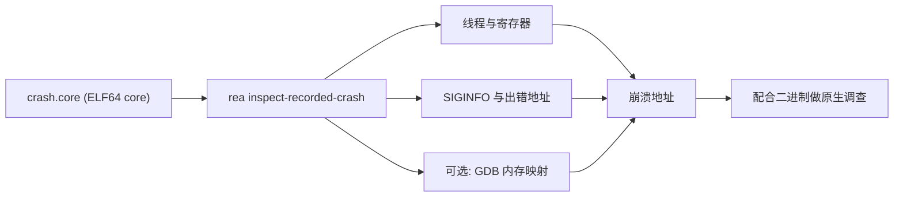

import { Meta } from '@storybook/addon-docs/blocks';

<Meta id="recorded-crashes" title="原生二进制/静态调查/崩溃记录" name="Docs" />

# 崩溃记录

程序崩溃后留下的 core 文件是崩溃那一刻的进程快照：各线程的寄存器、信号信息都被冻结在文件里。本课讲 REA 的崩溃记录调查——`inspect_recorded_crash` / `rea inspect-recorded-crash`：把一个离线的 Linux ELF core 解码成结构化证据，回答"哪个线程、因为什么信号、在哪个地址上崩溃"；再选择性地借助 GDB 取得内存映射，把崩溃地址对回所属模块。边界要先说清：REA 只负责解码与映射，不从 core 做符号化，也不重建调用栈——拿到崩溃地址之后，函数与调用链的解析要配合[原生调查](?path=/docs/native-investigation--docs)在对应二进制上完成。

REA 接受的崩溃记录只有一种格式：Linux ELF64 小端 core，架构限 x86-64 与 AArch64。Windows minidump、coredumpctl 日志文件等不在支持范围；systemd-coredump 存储的核心本身是 ELF core，导出成文件后即可交给 REA。



| 回查项 | 值与要点 |
| --- | --- |
| CLI 命令 | `rea inspect-recorded-crash PATH [--debugger-context] [--json]` |
| MCP 工具 | `inspect_recorded_crash`，入参 `path` 与 `include_debugger_context` |
| 支持格式 | Linux ELF64 小端 core；仅 x86-64 与 AArch64 |
| Python 依赖 | pwntools 4.15.0、pyelftools 0.33、Unicorn 2.1.2（REA 不安装） |
| 必设环境变量 | `REA_PWNTOOLS_PYTHON`，指向现成 venv 的 Python 绝对路径 |
| 调试器映射环境变量 | `REA_PWNDBG_GDB`（默认 `/usr/bin/gdb`）；`REA_PWNDBG_GDBINIT` 与 `REA_PWNDBG_VENV_PATH` 无默认值 |
| 输入上限 | 默认 32 MiB；`REA_PWNTOOLS_MAX_INPUT_BYTES` 最高可调到 1 GiB |
| 证据分级 | 无调试器映射为 observed；带映射为 derived |

## 快速上手

解码器不是 REA 自带的：先准备一个带固定版本依赖的 venv，导出路径，再跑一条命令。

```bash
python3 -m venv .venv-pwntools
.venv-pwntools/bin/pip install pwntools==4.15.0 pyelftools==0.33 unicorn==2.1.2
export REA_PWNTOOLS_PYTHON=$PWD/.venv-pwntools/bin/python
rea inspect-recorded-crash ./crash.core --json
```

从输出中直接核对三件事，就是定位崩溃点的最小闭环：

- 哪个线程出事：每个 `NT_PRSTATUS` note 对应一条线程记录，找到携带信号的线程。
- 什么信号、什么出错地址：读 SIGINFO 的 number/code/errno；SIGSEGV code 为 1 或 2 时，出错地址字段被建立。
- 崩在哪里：读该线程寄存器集里的指令指针（amd64 是 `rip`，AArch64 是 `pc`）。

`--json` 遵循 REA 全局输出约定：终端上缩进展示，管道或重定向时输出紧凑格式；结果与 Evidence 内联返回，包含工件路径、SHA-256 与大小。

## 导入崩溃记录

REA 把 core 当只读证据解码：不执行其中任何内容，也不需要崩溃时的那个程序在场。导入前要确认格式边界与解码依赖两件事。

### 格式与架构边界

只接受 Linux ELF64 小端 core。`e_machine` 不是 x86-64 或 AArch64 会得到 `unsupported_target`；OSABI 只接受 System V/unspecified 与 ABI 版本为 0 的 GNU/Linux，其他声明的 ABI 同样返回 `unsupported_target`。

解码是全量的、可追溯的：程序头、各段（segment）的文件与内存范围、每条 note 的原始字节及其来源范围都进入结果；ELF 与 note 头独立绑定，支持扩展的程序头数量。note 的物理范围不允许互相重叠或在段内留间隙——结构异常的 core 会在这些检查上暴露出来。

### 解码依赖

解码在调用方提供的 Python 里执行，由 `REA_PWNTOOLS_PYTHON` 指定，要求的依赖版本固定为 pwntools 4.15.0、pyelftools 0.33、Unicorn 2.1.2，且不能是改动过的包——REA 不负责安装它们。

输入默认上限 32 MiB。core 更大时用 `REA_PWNTOOLS_MAX_INPUT_BYTES` 单独调高，最高 1 GiB；该变量必须是合法范围内的十进制整数，否则返回 `provider_unavailable`。回复上限 64 MiB、诊断上限 1 MiB、30 秒墙钟与 CPU 软上限、3 GiB 地址空间软上限都是固定值：继承到的更紧限制会被保留，硬上限不会被抬高，这些限制不构成沙箱。

### 从 systemd-coredump 导出

REA 文档没有直接对接 coredumpctl 日志；但 systemd-coredump 存储的核心本身就是 ELF core，用系统工具导出成文件即可交给 REA（以下属 systemd 侧操作）：

```bash
coredumpctl list myapp
coredumpctl dump myapp --output=./crash.core
rea inspect-recorded-crash ./crash.core --json
```

Windows minidump 与各类日志格式不被接受，需先转换成 ELF core 才有入口。

### MCP 调用

MCP 形态的程序化调用是 `inspect_recorded_crash`，入参为 `path` 与可选的 `include_debugger_context`；省略该开关表示只要记录内的证据：

```json
{ "path": "/artifacts/crash.core", "include_debugger_context": true }
```

## 定位崩溃点

core 里没有"崩溃点"这个现成字段；崩溃点由两类记录拼出来——线程寄存器给出指令指针，SIGINFO 给出信号与出错地址。

### 线程与寄存器

每条 Linux CORE `NT_PRSTATUS` note 解码为一条独立的线程记录，带历史 PID、信号和完整的 ABI 寄存器集：amd64 为 27 个寄存器，AArch64 为 34 个，全部是无损 uint64，寄存器名绑定到原始 ABI 偏移，并绑定到来源字节。

判断时注意两点。其一，历史 PID 只是元数据，永远不会被用于选择或附加（attach）活进程。其二，note 解释的完整性与信号-线程归属在文档中标注为未知：core 里有多条线程时，要结合信号与寄存器自行确认真正的崩溃线程，缺某条 note 也不代表崩溃时它不存在。

### SIGINFO 与出错地址

结果携带带符号的 SIGINFO number/code/errno。出错地址字段只在 SIGSEGV code 为 1 或 2 时建立（即 fault-address union）；其他 SIGSEGV 变体只保留原始字节，含义未知。

code 1/2 的语义来自 Linux 通用约定：1（`SEGV_MAPERR`）表示访问了未映射的地址，2（`SEGV_ACCERR`）表示地址已映射但权限不符。判断崩溃点时区分两个地址：指令指针（`rip` / `pc`）指向触发异常的那条指令，出错地址（SIGINFO 携带）是引发异常的那次内存访问的目标——前者回答"崩在哪条指令"，后者回答"访问了什么地址不该访问"。

## 回溯到函数与调用链

崩溃地址本身只是数字；回溯分两步——用可选的调试器映射上下文把地址对到模块区间，再用原生调查在模块对应的二进制上解析函数与调用链。REA 不会自动做符号化。

### 调试器映射上下文

加 `--debugger-context`（MCP 为 `include_debugger_context: true`）后，REA 通过 GDB 加 pwndbg 的桥取得内存映射。环境变量：`REA_PWNDBG_GDB` 指定 GDB 路径（默认 `/usr/bin/gdb`）；`REA_PWNDBG_GDBINIT` 指向未改动的 pwndbg `gdbinit.py`，`REA_PWNDBG_VENV_PATH` 指向现成 pwndbg venv，两者都没有默认值，且必须是存在的绝对路径。已验证的组合是 Linux x64 上的 GDB 13.1 加 pwndbg 2026.09.15，CI 另覆盖 Debian 13 加 GDB 16。

桥以受控方式运行 GDB：不加载 init 文件、关闭 auto-load 与 debuginfod、不自动加载共享库，库路径与缓存为空，debug 文件查找限制在自有空目录里。它先用占位符 `exec-file /proc/self/exe` 占住 GDB 的可执行文件槽位、显式选择 core 的架构，再在查询映射候选前用 `file` 丢弃占位符，并验证 core 连接与"无主符号文件"这一前提。调用方拿不到任何 GDB 命令语言接口。

两个安全与可信边界。`NT_FILE` 描述符会预先检查：映射名必须是绝对 Unix 路径且不含 dot 段，否则拒绝富化、保留基础解码。请求了调试器上下文但环境不可用时，REA 给出可操作的失败，而不是静默省略该部分。

### 从地址到模块与函数

映射上下文给每条映射三个要素：名称（绝对路径形式）、范围与权限。判断流程是把崩溃地址和指令指针逐一对照映射范围，命中的区间即所属模块；权限由报告的 flags 推导，flags 为零或陌生时权限未知。

拿到模块后，符号层面的回溯要换工具：把该模块的二进制交给[原生调查](?path=/docs/native-investigation--docs)，用 `analyze` 建会话、`function` 与 `decompile` 看函数、`xrefs` 与 `trace` 追引用和调用路径——这一步才有函数名与调用链。

对映射的结论要保持克制：名称只是生产者留下的显示元数据，当前文件身份未知；映射不证明页内容，也不证明与某个可执行文件匹配。崩溃时未转储的内存与当时的可执行文件、库身份同样保持未知。证据分级随之变化：无映射的检查结果为 observed，带映射的为 derived。

## 最佳实践

- **先跑基础解码，再决定是否加映射。** `--json` 基础解码已能回答"哪个线程、什么信号、哪个地址"；只有当下一步必须知道地址属于哪个模块时才加 `--debugger-context`，并接受证据从 observed 变为 derived。
- **把地址回溯拆给对应工具。** 映射区间回答"在哪个模块"，函数与调用链靠原生调查在二进制上完成；不要期待 REA 从 core 直接给出符号名或栈回溯。
- **大 core 先调上限再重试。** 超过 32 MiB 时设置 `REA_PWNTOOLS_MAX_INPUT_BYTES`，按需给到 1 GiB 以内；它只放开输入一项，其余上限固定。
- **结论随手落 Evidence。** 结果与 Evidence 内联返回，把检查结论与后续二进制分析固化为可导出、可比较的证据包，便于跨会话复核。

## 常见问题

- 返回 `unsupported_target`
  确认 core 是 Linux ELF64 小端、`e_machine` 为 x86-64 或 AArch64，且 OSABI 是 System V/unspecified 或 ABI 版本 0 的 GNU/Linux；其余组合一律拒绝。
- 返回 `provider_unavailable`
  检查 `REA_PWNTOOLS_PYTHON` 是否指向存在的 venv Python、三个依赖是否为固定版本，以及 `REA_PWNTOOLS_MAX_INPUT_BYTES` 是否是合法范围内的十进制整数。
- 请求了 `--debugger-context` 却直接失败
  这是设计行为：环境不可用时给可操作的失败而非静默省略。逐项确认 `REA_PWNDBG_GDB`、`REA_PWNDBG_GDBINIT`、`REA_PWNDBG_VENV_PATH` 都是存在的绝对路径，后两者没有默认值。
- 映射名是个路径，按它找文件却对不上
  映射名只是生产者的显示元数据，当前文件身份未知；回查时以范围归属判断模块，文件身份再用原生调查手段另行确认。
- 映射结果缺失、只有基础解码
  通常是 `NT_FILE` 映射名不是绝对路径或含 dot 段，富化被拒绝但基础解码保留；换用干净的 core 或修正来源后再试。

## 总结回顾

摘要：

崩溃记录调查把一个离线的 Linux ELF64 core 变成结构化证据：解码由调用方提供的 pwntools 环境完成，输出保留程序头、段范围与全部 note，并把每条 `NT_PRSTATUS` 变成带历史 PID、信号和完整寄存器集的线程记录；SIGINFO 在 SIGSEGV code 1/2 时给出出错地址，与指令指针一起拼出崩溃点。加 `--debugger-context` 后，GDB 加 pwndbg 的桥在隔离前提下补上内存映射，把崩溃地址对到模块区间；符号与调用链则要拿地址到对应二进制上用原生调查解析。全程的证据分级、上限与拒绝条件都有明确定义。

一句话：

> REA 负责把 core 解码成线程、寄存器、信号与可选内存映射，崩溃地址到函数与调用链的最后一跳要靠你拿地址配合二进制完成。

知识要点：

- REA 接受哪种崩溃记录格式，哪些输入会被 `unsupported_target` 拒绝？
- 导入前必须准备哪些环境变量与依赖，版本要求是什么？
- 怎样从输出中确认崩溃线程、出错地址和指令指针？
- `--debugger-context` 额外提供什么，代价与安全边界是什么？
- 拿到崩溃地址后，用什么命令继续解析函数与调用链？

## 参考资料

- [Recorded crashes — REA docs](https://github.com/morluto/rea/blob/main/docs/recorded-crashes.md)
- [CLI — REA docs](https://github.com/morluto/rea/blob/main/docs/cli.md)
