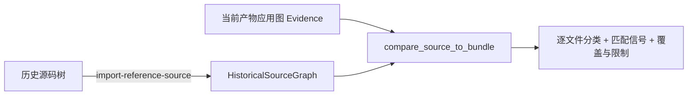

import { Meta } from '@storybook/addon-docs/blocks';

<Meta id="reference-source-compare" title="Evidence 与重建/历史源码比对" name="Docs" />

# 历史源码比对

手上有一份历史源码树（比如旧版本的完整源码）时，REA 可以把它导入成一份密码学承诺的 `HistoricalSourceGraph`，再与当前产物逆向出的应用图 Evidence 做逐文件比对：每个历史源文件被归入 `unchanged`、`modified`、`removed`、`split`、`merged`、`duplicated`、`unknown` 七类之一，并报告建立映射时采纳的全部信号与权重。整条链路是纯静态的——导入只读不写，比对不读文件、不执行代码、不附加进程，结论是文件级身份映射，不声称运行时加载或语义等价。

链路两端与产物如下：



回查先看这张表：

| 项 | 值 |
| --- | --- |
| 导入命令 | `rea import-reference-source /absolute/path/to/source` |
| `--detail` | `full`（默认）/ `summary`；只有 `full` 的图谱能参与比对 |
| `--outline-depth` | 仅配合 `--detail summary`；默认 2；0 省略全部 outline 条目 |
| 保存输出 | 默认 TOON；保存成文件加 `--json` |
| 默认排除 | 遵循源码树 `.gitignore`；`node_modules/`、`dist/`、`*.log` 等生成与依赖路径 |
| 主机要求 | Linux / macOS；原生 Windows 报 `unsupported_host` |
| 比对命令 | `rea compare-source-to-bundle`（MCP 工具 `compare_source_to_bundle`） |
| 比对输入 | full 导出的 `HistoricalSourceGraph` + 已认证应用图 Evidence |
| 分类取值 | `unchanged` / `modified` / `removed` / `split` / `merged` / `duplicated` / `unknown` |

## 快速上手

前提：REA 已安装（见「安装与设置」一课）；手上有两份材料——当前部署的 JavaScript 应用（或其打包产物目录）与它的历史源码树。最小闭环三步：分析当前侧、导入历史侧、比对。

```bash
# 1. 静态分析当前产物，得到应用图 Evidence
rea analyze-javascript-application /absolute/path/to/current-app --json > app-evidence.json

# 2. 导入历史源码树：比对必须用 full，加 --json 保存
rea import-reference-source /absolute/path/to/old-source --json > historical-source.json

# 3. 比对：历史源码图与已认证应用图 Evidence 各占一侧
rea compare-source-to-bundle historical-source.json app-evidence.json --json > comparison.json
```

可观察结果：

- 比对返回历史侧全部源文件的分类：每个文件归入七类之一，每个映射附全部被采纳的信号与权重，外加覆盖与限制信息。
- 比对本身无 I/O：不读文件、不执行代码、不附加进程、不打开原生分析 provider；同一批输入重跑得到相同结论。
- 边界：分类是静态映射，不声称运行时加载或语义等价；`unknown` 是显式结论，不是失败。

## 导入历史源码

`import-reference-source` 对源码树做一次纯读取的盘点并提交承诺：记录所提供文件的哈希与元数据，与对当前应用的观察分开保存；源码树本身不被修改。导入有两种输出投影，由 `--detail` 选择，二者执行完全相同的盘点与清理——区别只在返回给你多少内容。

### full 与 summary

```bash
# 完整图谱：source-to-bundle 比对的唯一合格输入
rea import-reference-source /absolute/path/to/source --json > historical-source.json

# 摘要投影：给人看的大纲与统计
rea import-reference-source /absolute/path/to/source --detail summary --json
```

- `--detail full`（默认）：返回完整的 `HistoricalSourceGraph`，即参与比对工作流的那份承诺图。
- `--detail summary`：返回 `HistoricalSourceSummary`，其中的 manifest 包含完整图谱与根摘要，以及 provenance、VCS facts、languages、manifest paths、entry/relationship counts、parse-failure counts、file/directory states、exclusions 和 limitations。

关键边界：summary 是展示视图，不是比对接受的输入——官方原文明确"keep the full output for that workflow"。要跑比对，保留 full 输出。另外 summary 只减少选定输出，不减少实际盘点的源码量，官方也不承诺固定的输出体积或运行时间改进。

### 大纲深度（--outline-depth）

`--outline-depth` 只在 `--detail summary` 下有效，接受非负整数，控制摘要里目录大纲展开几层：depth 1 显示根的直接子项，depth 2（默认）再显示孙项，depth 0 省略全部 outline 条目。

```bash
rea import-reference-source /absolute/path/to/source --detail summary --outline-depth 1 --json
```

`outline.omitted_entry_count` 只统计因所选深度被隐藏的已盘点条目：被排除或不可读目录里未检查的子项不计入，该计数也不改变 `inventory_state`。换句话说，调小深度省的是输出，不是盘点。

### 排除与敏感路径

导入遵循源码树自身的 `.gitignore`，并默认排除常见生成与依赖路径（如 `node_modules/`、`dist/`、`*.log`）。每条基于模式的排除都记录匹配的 pattern 及其来源：`project`、`default`、`caller` 或 sensitive path policy。

```bash
# 用环境变量把额外模式标记为敏感路径，作为 configured-secret exclusions 单独报告
REA_REFERENCE_SECRET_PATTERNS_JSON='["*.pem","**/*.key"]' \
  rea import-reference-source /absolute/path/to/source --json
```

`REA_REFERENCE_SECRET_PATTERNS_JSON` 取一个 JSON 数组。源码树位于 Git checkout 内时，导入会记录该仓库最近的 HEAD，但工作树是否与该 commit 一致保持未知——这个事实不会替你背书。

### 导入边界

- **主机**：导入依赖 Linux 或 macOS 上的安全 no-follow 文件打开；原生 Windows 报 `unsupported_host`，在 WSL 等环境中运行。
- **编码**：JavaScript/TypeScript 解析要求有效 UTF-8；损坏字节保留原哈希与大小并附带解码诊断，进入 parse-failure counts。
- **变化中的树**：导入期间发生变化的条目保留 unavailable-entry 诊断；根目录枚举失败记为顶层 limitation——它不证明未检查子项里不存在目标。
- **度量口径**：路径按规范 Unicode 码点序排列；`file_sizes.known_bytes` 是已知文件大小之和的精确十进制文本，未知大小计入 `file_sizes.unknown_file_count`，被排除或未检查的路径不计入——因此零值不能证明源码树为空。
- **旧图谱兼容**：已保存图谱中基于模式的排除若缺少 `pattern` 字段，必须先重新导入才能用于 source-to-bundle 比对。

## 源码到产物比对

`compare_source_to_bundle`（CLI：`compare-source-to-bundle`）把一份密码学承诺的 `HistoricalSourceGraph` 与一份已认证的应用图 Evidence 做静态映射。它消费 `analyze_javascript_application` 或 `reconcile_javascript_runtime` 产生的 Evidence，自身不做任何 I/O。

### 准备比对输入

两侧输入各就各位：

- 历史侧：`--detail full` 导入并保存的图谱 JSON。summary 投影不被接受。
- 当前侧：已认证的应用图 Evidence，来自静态分析或运行时对账。

输入可以是完整内联 Evidence，或对当前连接已保留记录的精确引用（4.1.0 之前的版本只接受内联）：

```json
{ "kind": "retained-evidence", "evidence_id": "ev_RETURNED_ID" }
```

引用属于当前 MCP 连接的 Evidence ledger；独立 CLI 进程没有 retained 状态，也解析不了另一个 MCP 连接的保留记录——CLI 场景直接用文件路径传完整 JSON。Evidence 包的导入导出与 retained 记录管理见「Evidence 包管理」一课。

### 匹配信号与优先级

比对按稳定的打分模型为每个历史源文件寻找当前侧候选，所有被采纳的信号和权重都会报告：

| 信号 | 类别 | 读法 |
| --- | --- | --- |
| `exact source digest` | 内容 | 最强：精确内容摘要一致，胜过一切位置推断 |
| `source-map original path` | 位置 | source-map 记录的原始路径 |
| `exact current path` | 位置 | 当前路径精确一致 |
| `path suffix` | 位置 | 路径后缀一致 |
| `Unicode-equivalent path` | 弱 | 规范等价拼写，只作候选证据 |
| `basename` | 弱 | 文件名一致 |
| `language extension` | 弱 | 语言扩展名一致 |

优先级规则两条：精确 digest 胜过位置推断；弱信号永远不会强制建立映射。Unicode 等价拼写只是候选证据——不同文件系统路径可能各自独立保留等价拼写，存在多个规范等价候选时结果保持 `unknown`。

### 七类分类

每个历史源文件得到一个分类结论：

| 分类 | 判定 | 回查看点 |
| --- | --- | --- |
| `unchanged` | 与当前侧建立了稳定对应 | 内容与身份都对得上 |
| `modified` | 找到对应，但不再是精确同一 | 看采纳的信号判断映射强度 |
| `split` | 多个得分相同的路径映射 | 静态 split 推断，一个历史文件对应多个候选 |
| `merged` | 多个历史路径与同一当前节点精确同一 | 多个旧文件并入了同一个新文件 |
| `duplicated` | 多个当前节点具有相同的历史 digest | 同一份内容被复制到多处 |
| `removed` | 历史与应用两侧都有完整清单时的缺席 | 部分清单无法证明缺失，保持 `unknown` |
| `unknown` | 无法建立结论 | 显式保留，不伪装成其他分类 |

这些是静态映射结论，官方明确"do not claim runtime loading or semantic equivalence"：说一个文件 `unchanged` 只说明字节身份对得上，不说明这个文件在运行时被加载，更不说明功能语义等价。要往重建推进，见「重建工作流」一课。

## 最佳实践

- **比对前保留 full 输出。** summary 是给人看的投影，不能当比对输入；养成 `--detail full --json` 落盘的习惯，摘要需求另跑一次 `--detail summary`。
- **当前侧证据质量决定比对上限。** 比对消费静态分析或运行时对账产生的应用图 Evidence——对账后的组合图能提供更准的当前侧身份；静态映射再强也补不了当前侧 Evidence 的覆盖缺口。
- **两侧清单越完整，`removed` 越可信。** 排除口径（`.gitignore` 差异、生成目录是否入树）直接改变两侧清单的分母；判定前核对 exclusions 与 limitations，旧保存图谱缺 `pattern` 字段先重新导入。
- **把 `unknown` 当结论引用。** 多候选、Unicode 等价歧义、清单不完整都落在 `unknown`；引用比对结果时保留分类与信号权重，不要把 `unknown` 洗成"没变"。
- **用仓库验证器做回归核对。** 在 REA 仓库内可运行 `npm run verify:application-workflows -- --left /absolute/path/to/version-a --right /absolute/path/to/version-b`，验证器独立重建两个版本并比对，`--left-module-path`、`--left-export-name`、`--right-module-path`、`--right-export-name` 可选验证显式 export 对；输出只打印图、工件与 Evidence 标识符及统计，不打印源码文本。

## 常见问题

- 拿 `--detail summary` 的输出去比对，为什么不被接受？
  summary 是展示投影，不是比对接受的承诺图。用 `--detail full` 重新导入（或翻出之前 full 模式保存的 JSON）再跑比对；summary 与 full 盘点的源码量相同，重跑只多花一次输出组织。
- 分类是 `removed`，能断定这些文件被删了吗？
  只有历史与应用两侧都有完整清单时 `removed` 才成立。清单不完整时无法证明缺席，结果保持 `unknown`；先检查当前侧排除口径是否吃掉了本该出现的文件。
- 出现一堆 `unknown`，是哪里出了问题？
  常见来源是弱信号歧义：多个规范等价（Unicode）候选、只剩 basename 或扩展名可依。弱信号永不强制建立映射，这是设计行为；补强当前侧证据（精确路径、source-map、digest）而不是反复重跑。
- 文件分类是 `unchanged`，能认为这个功能没变吗？
  不能。分类是文件级静态映射，不声称运行时加载或语义等价——调用关系、配置、构建产物都可能变。要行为层面的结论，另做运行时观测或功能追踪。
- Windows 上导入报 `unsupported_host`？
  导入依赖 Linux/macOS 的安全 no-follow 文件打开，原生 Windows 不支持；在 WSL 等环境中对同一路径运行导入。

## 总结回顾

摘要：

历史源码比对分两步：先用 `import-reference-source` 把旧源码树盘点成密码学承诺的 `HistoricalSourceGraph`——导入遵循 `.gitignore` 与默认排除，记录哈希、provenance 与 Git HEAD，敏感路径可用 `REA_REFERENCE_SECRET_PATTERNS_JSON` 单独标记；`--detail summary` 加 `--outline-depth` 只裁剪输出投影，`full` 才是比对合格输入。再用 `compare_source_to_bundle` 把这份图谱与当前产物的应用图 Evidence 做静态映射：精确 digest 胜过位置推断，basename、扩展名、Unicode 等价这类弱信号永不强制建立映射；每个历史文件归入七类之一，`removed` 需要两侧完整清单，其余对不上的显式落 `unknown`。整条链路无 I/O、可重复，结论止于文件身份，不声称运行时加载或语义等价。

一句话：

> 历史源码比对给出的是文件级身份分类，不是语义结论：full 图谱进比对，弱信号不定身份，对不上就 `unknown`。

知识要点：

- 导入的 `full` 与 `summary` 各返回什么，为什么只有 `full` 能参与比对？
- `--outline-depth` 的 depth 0/1/2 各显示什么，`omitted_entry_count` 统计什么、不统计什么？
- 导入的排除规则有哪些来源，敏感路径怎么标记，Git HEAD 记录了什么、没承诺什么？
- 比对的七种匹配信号按什么优先级工作，弱信号为什么永不强制建立映射？
- 七类分类各自的判定条件是什么，`removed` 与 `unknown` 的分界在哪里？
- 比对结论的三条硬边界（无 I/O、静态映射、不声称语义等价）各意味着什么？

## 参考资料

- [REA CLI 参考（import-reference-source）— morluto/rea docs](https://github.com/morluto/rea/blob/main/docs/cli.md)
- [JavaScript application workflows（historical source-to-bundle comparison）— morluto/rea docs](https://github.com/morluto/rea/blob/main/docs/javascript-application-workflows.md)
- [MCP contracts（retained-evidence 输入形式）— morluto/rea docs](https://github.com/morluto/rea/blob/main/docs/mcp-contracts.md)
