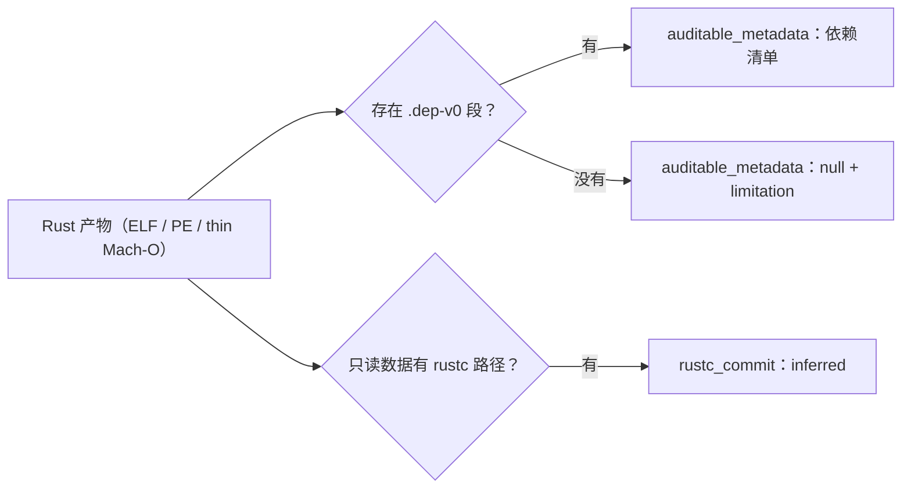

import { Meta } from '@storybook/addon-docs/blocks';

<Meta id="rust-binaries" title="原生二进制/语言与平台/Rust 二进制" name="Docs" />

# Rust 二进制

Go 二进制的构建元数据常驻在产物里，Rust 不是：release 产物默认不带可读的依赖信息，除非构建时用了 cargo-auditable，把依赖清单压缩嵌入 `.dep-v0` 段。本课的命令 `rea inspect-rust-binary` 就负责读这段清单：给定一个本地可执行文件或库，离线解出 crate 名、版本、来源、依赖边与环，全程不运行文件，也不需要 Rust 安装、活跃 binary target 或 Hopper、Ghidra、IDA。读不到清单时它不猜——返回明确的 `auditable_metadata: null` 加 limitation，此时唯一的编译器线索是只读数据里的 `/rustc/<40-hex>/` 路径，证据级别标为推断（`inferred`）。



| Evidence 内容 | 出现条件 | 回答的问题 |
| --- | --- | --- |
| 文件标识（路径、SHA-256、字节数、容器格式、架构、字长、字节序） | 总是 | 读的是哪个文件、什么格式 |
| `auditable_metadata` | 存在 `.dep-v0` 段 | 依赖了哪些 crate、什么版本、依赖边与环 |
| `rustc_commit` | 只读数据出现 `/rustc/<40-hex>/` 路径 | 编译器 commit 线索（`inferred`） |
| `auditable_metadata: null` + limitation | 没有 `.dep-v0` 段 | 无清单不等于无依赖 |

## 快速上手

一条命令，两种结果。有清单的产物返回 `auditable_metadata`；没嵌入清单的产物同样成功返回，只是 `auditable_metadata` 为 `null`：

```bash
# 有 cargo-auditable 清单的产物
rea inspect-rust-binary /absolute/path/to/application --json

# 没有清单的产物：同样成功返回，只是 auditable_metadata 为 null
rea inspect-rust-binary /absolute/path/to/legacy-server --json
```

MCP 侧等价调用要求绝对路径：

```json
{
  "name": "inspect_rust_binary",
  "arguments": { "path": "/artifacts/application" }
}
```

两个结果共享同一组文件标识：artifact path、SHA-256、byte length、container format、architecture、word size、byte order——先核对读的确实是目标文件，再看元数据分支。容器必须是 ELF、PE 或 thin Mach-O；Universal Mach-O（fat binary）不支持，先用 `lipo -thin` 之类的工具取出单一架构切片再检查。

## 依赖清单

cargo-auditable 在构建时把依赖图——包列表加依赖边——压缩成一段 JSON 嵌入 `.dep-v0` 段；REA 解压、校验后按段内原始顺序返回。清单是构建时的文件内容：它说明构建时嵌入方声明并锁定的依赖关系，不是运行时加载了什么，也不为名字与版本背书。

### 调用与文件标识

CLI 按调用方工作目录解析相对路径；MCP 要求绝对路径并保持所选文件不变。命令不运行目标，只需要文件可读：

```bash
rea inspect-rust-binary /absolute/path/to/application --json
```

Evidence 结果总是带一组文件标识，用作证据链锚点：

| 字段 | 含义 |
| --- | --- |
| artifact path | 所选文件路径 |
| SHA-256 | 文件摘要 |
| byte length | 文件字节数 |
| container format | 容器格式（ELF / PE / Mach-O） |
| architecture | 目标架构 |
| word size / byte order | 字长与字节序 |

### 清单字段与默认值

`auditable_metadata` 仅在 `.dep-v0` 段存在时出现，字段如下：

| 字段 | 内容 |
| --- | --- |
| `section_name` | ELF 与 PE 为 `.dep-v0`；thin Mach-O 为 `__DATA,.dep-v0` |
| `file_offset` / `section_bytes` | 压缩段在文件中的精确范围 |
| `compressed_bytes` / `uncompressed_bytes` | 压缩前后字节数 |
| `format_version` | 嵌入的版本整数；嵌入时省略则为 `null` |
| `packages` | 包列表，保持段内原始顺序；每项含 `name`、`version`、`source`、`kind`、`dependencies`、`root` |
| `root_package_index` | 唯一被标记 `root` 的包的下标；没有标记则为 `null` |
| `dependency_edges` | 包下标对，package-then-dependency 顺序 |
| `cyclic_dependency_indices` | 参与依赖环的包下标，去重并排序 |

嵌入格式层面的缺省值——嵌入时省略这些字段，返回时按下面处理：

| 嵌入时省略 | 返回值 |
| --- | --- |
| `kind` | `null`（格式把省略解释为 runtime，但默认值本身不写入段内） |
| 依赖列表 | 空数组 |
| `root` 标记 | `false` |

依赖环被报告而不被遍历：`cyclic_dependency_indices` 列出参与环的包下标，读取不会沿环走，环也不会导致失败。`root_package_index` 指认嵌入方标记的唯一根包，是清单里定位应用自身的入口。

## 没有 auditable 标记时

缺 `.dep-v0` 段不是失败：命令成功返回，`auditable_metadata` 为 `null`，并附一条 limitation。官方口径很直接：没有 `.dep-v0` 不代表这个二进制没有依赖——清单只存在于 cargo-auditable 嵌入过的构建产物里，其余构建路径不会有这段。

此时唯一的编译器线索是 `rustc_commit`：只在只读数据中出现 `/rustc/<40-hex>/` 路径时给出，`evidence_kind` 为 `inferred`。两个限制要记住：hash 不是"该编译器构建了此文件"的声明；多个不同 hash 可能对应同一个未知 commit，单个 commit 因此无法锁定。

元数据层面能回答的问题到此为止。null 分支之后，代码与行为层面的调查回到原生调查主线（`analyze`、`decompile`、`xrefs` 等，见[原生调查](?path=/docs/native-investigation--docs)一课）。

## 限制与失败

四项大小预算：

| 项 | 限制 |
| --- | --- |
| 选定文件 | 256 MiB |
| 依赖段（压缩后） | 1 MiB |
| 解压后的 JSON | 取 8 MiB 与 64 倍压缩大小的较小者 |
| 完整报告 | 8 MiB |

超限与畸形输入都是 typed failure，没有部分结果：空段、截断或尾随 zlib 字节、无效 JSON、未知字段、包列表之外的依赖下标、多于一个 root 包、压缩的依赖段。包与依赖数量在分配图或克隆 schema 之前，先按最小 JSON 表示预检；超限的图报告输出字节预算。编译器路径的容量单独用 `maximum_rustc_hashes` 按 hash 个数报告，与字节限制无关。

未知格式版本不拒绝：版本号保留在 `format_version`，按已知的最高前序版本解释（遵循 cargo-auditable schema）；输出带 limitation 指明这次回退，并注明该版本未经独立验证。省略版本保持 `null`，按 revision 0 语义解释。

信任边界是本课的底线：嵌入的名字与版本是文件内容，它们不认证包，也不认证编译器。

容器支持：ELF、PE、thin Mach-O 三种；Universal Mach-O 不支持，先选 thin slice。

## 最佳实践

- **先读清单，再决定要不要上引擎。** 这条命令不需要 provider、不运行文件，是原生分析里成本最低的一步：有清单直接拿到依赖面；null 结果说明元数据路径到此为止，转原生调查，不浪费 provider 配置时间。
- **把清单当审计线索，不当审计结论。** 版本号来自构建时的嵌入内容：对照已知漏洞时引用具体 `name` / `version` 加文件 SHA-256，并保留对应 limitation——嵌入内容不为包或编译器背书。
- **用文件标识锚定证据链。** artifact path、SHA-256、byte length、container format 每次调用都返回；`file_offset` 与 `section_bytes` 给出清单段在文件中的精确位置。把这些写进分析笔记，后续任何工具复核的都是同一段字节。

## 常见问题

- `auditable_metadata` 是 `null`，能断定没有第三方依赖吗？
  不能。缺 `.dep-v0` 段只说明这份产物没有嵌入清单，官方明确"没有 `.dep-v0` 不等于没有依赖"。改走代码层路径，用原生调查的 `analyze` / `decompile` 继续。
- rustc hash 能当编译器版本证据吗？
  只能当线索。`evidence_kind` 是 `inferred`：hash 不是"该编译器构建了此文件"的声明；出现多个不同 hash 时，单个 commit 无法确定。
- fat binary（Universal Mach-O）直接报错？
  先提取单一架构的 thin slice 再检查。ELF、PE、thin Mach-O 是仅有的三种支持容器。
- 依赖环会导致读取失败或卡住吗？
  不会。环被报告进 `cyclic_dependency_indices`，读取不沿环遍历。
- 结果会被悄悄截断或缩减吗？
  不会。所有预算超限都是 typed failure，没有部分成功；包与依赖数量在分配前按最小 JSON 表示预检，超限报告输出字节预算。唯一带推断的路径是未知 `format_version` 的回退解释，且有 limitation 标注。
- 命令会把目标跑起来吗？
  不会。它只读取文件，不运行文件，也不需要 Rust 安装或活跃 binary target。

## 总结回顾

摘要：

本课覆盖 REA 读取 Rust 二进制元数据的完整路径。`rea inspect-rust-binary` 离线读取 cargo-auditable 构建时嵌入的 `.dep-v0` 清单：调用后先核对文件标识（路径、SHA-256、字节数、容器、架构、字长、字节序），清单存在时逐字段读 `auditable_metadata`——段名与文件范围、压缩前后字节数、版本号、按原始顺序排列的包列表、根包下标、依赖边与依赖环，省略字段按固定缺省值返回。没有清单时命令照样成功，`auditable_metadata` 为 `null` 加 limitation，官方明确这不证明无依赖；此时只剩只读数据里 `/rustc/<40-hex>/` 路径推出的 `rustc_commit`，证据级别是推断。256 MiB 文件、1 MiB 压缩段、8 MiB 解压与报告的预算约束下，畸形输入一律 typed failure；未知格式版本按前序版本回退解释并标注。嵌入的名字与版本是文件内容，不认证包或编译器。

一句话：

> Rust 二进制的依赖面取决于构建时是否嵌入 cargo-auditable 清单：有就离线读清单，没有就拿到明确的 null 与推断级编译器线索——REA 读的是文件内容，不为它作证。

知识要点：

- `inspect-rust-binary` 需要哪些前置？CLI 与 MCP 在路径处理上有何差异？
- `auditable_metadata` 有哪些字段？`kind`、依赖列表、`root` 缺省时分别返回什么？
- `root_package_index`、`dependency_edges`、`cyclic_dependency_indices` 各自怎么读？
- `rustc_commit` 何时出现？`inferred` 意味着哪两重限制？
- `auditable_metadata: null` 说明什么、不能说明什么？下一步去哪？
- 四项大小预算是多少？哪些输入是 typed failure？Universal Mach-O 怎么处理？

## 参考资料

- [Rust binary dependency metadata（docs/rust-binaries.md）](https://raw.githubusercontent.com/morluto/rea/main/docs/rust-binaries.md)
  本课主文档：`.dep-v0` 清单字段与缺省值、`rustc_commit` 推断证据、预算与 typed failures、未知版本回退与信任边界。
- [REA CLI reference（docs/cli.md）](https://raw.githubusercontent.com/morluto/rea/main/docs/cli.md)
  `inspect-rust-binary` 命令条目的出处，以及 `--json` 输出选择等全局 CLI 行为的一手依据。
