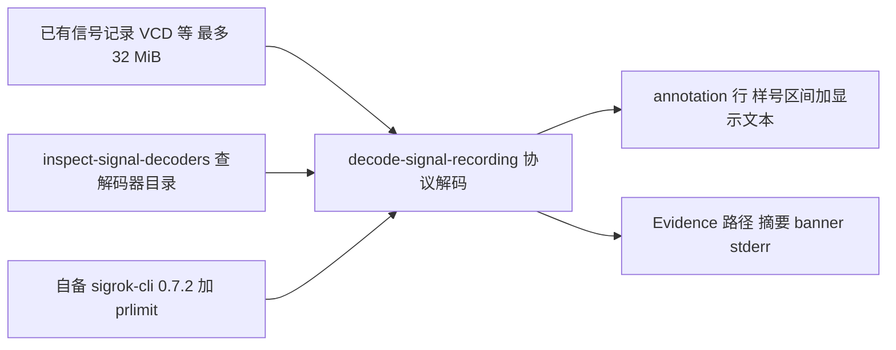

import { Meta } from '@storybook/addon-docs/blocks';

<Meta id="signal-recordings" title="固件、数据与流量/信号记录" name="Docs" />

# 信号记录

REA 的信号通道把已有的逻辑信号记录——逻辑分析仪等渠道采集的 VCD 等格式文件——交给调用方自备的 sigrok-cli 0.7.2 做协议解码：你指定解码器与通道映射，REA 在 Linux 上经 `prlimit` 约束运行它，读回解码器的 annotation 显示文本，形如 `1104-1938 uart-1: 52` 的行，给出样号区间和显示内容。这条通道不做硬件采集、不与设备通信，也不把显示文本解析成时间戳或已验证的协议事实；通道接线、波特率这类参数由你对照记录提供，REA 不猜。macOS 与 Windows 直接被拒绝，因为地址空间上限无法在这些主机上强制。本课是「固件、数据与流量」阶段的最后一课，面向硬件通信侧的记录，与 PCAP 的网络流量侧互补。



默认值与预算是本课的回查入口，后文所有小节都以这张表为基准：

| 项目 | 值 |
| --- | --- |
| 解码引擎 | 调用方自备 sigrok-cli 0.7.2（libsigrokdecode），绝对路径经 `REA_SIGROK_COMMAND` |
| 进程限制器 | util-linux `prlimit`，默认 `/usr/bin/prlimit`，可用 `REA_SIGROK_PRLIMIT_COMMAND` 覆盖 |
| 平台 | 仅 Linux（macOS / Windows 被拒绝） |
| 输入 | 已有记录文件，私有副本最多 32 MiB |
| 单命令期限 | 墙钟 30 秒，CPU 30 秒 |
| 输出预算 | stdout 加 stderr 合计 4 MiB，超限失败而非截断 |
| 解码输出分页 | 默认 50 行；`--all_lines` / MCP `line_limit: null` 取剩余全部 |
| 发现输出分页 | 默认 50 条；`--all` 与 `--limit` 冲突 |
| 选择器上限 | 单个 8,192 UTF-16 code units，合计 32 KiB |

## 快速上手

前置：Linux 主机，自备 sigrok-cli 0.7.2 与 util-linux 的 `prlimit`（通常在 `/usr/bin/prlimit`），详见[提供分析工具](#提供分析工具)。以绝对路径导出环境变量：

```sh
export REA_SIGROK_COMMAND=/absolute/path/to/sigrok-cli
```

先查已安装的解码器目录，再解码一条 VCD 记录：

```sh
rea inspect-signal-decoders --query uart
rea decode-signal-recording /artifacts/uart.vcd \
  --decoders uart:rx=RX:baudrate=9600 --input_format vcd
```

输出中应能核对到：第一条返回名字或 ID 含 uart 的解码器条目及其字面帮助文本；第二条返回注解显示行（样号区间加显示文本）和 `output_window` 计数。通道映射 `rx=RX` 的左边是解码器通道名，右边必须与记录里的信号名一致——对不上就得不到注解，用 inspect 命令查清每个解码器要求的通道再写。

## 提供分析工具

信号通道的解码引擎完全由调用方自备：REA 不安装 sigrok-cli、libsigrokdecode 或任何系统包，只在你发起解码时调用它，并用 `prlimit` 约束子进程。发现解码器同样依赖这套工具，但它不打开记录文件。

### 环境变量与版本要求

```sh
export REA_SIGROK_COMMAND=/absolute/path/to/sigrok-cli
export REA_SIGROK_PRLIMIT_COMMAND=/absolute/path/to/prlimit
```

`REA_SIGROK_COMMAND` 指向 sigrok-cli 可执行文件的绝对路径，版本预期为 0.7.2（带 libsigrokdecode）。`REA_SIGROK_PRLIMIT_COMMAND` 覆盖 `prlimit` 的路径，同样必须是绝对路径，默认取 `/usr/bin/prlimit`；限制器的路径、摘要与参数都会记入 Evidence。

### 平台边界与验证脚本

解码只在 Linux 上运行，macOS 与 Windows 的请求直接被拒绝：适配层无法在这些主机上强制地址空间上限。上游能力可用仓库自带脚本验证：

```sh
npm run build:cached
node scripts/verify-signal-recording.mjs
```

脚本合成一条 9600 波特 8N1 的 UART VCD（载有 `REA` 字样），检查 CLI 与 MCP 的一致性、schema、Evidence、哈希、注解过滤与自动检测、无效解码器与无效输入的失败路径，以及 Linux 上的清理。注意覆盖边界：这条 UART fixture 只确立 VCD 一种输入格式；其他格式、其他解码器和物理信号采集都没有被它建立。

## 解码已有记录

解码回答的问题是「所选协议解码器在这条已有记录里观察到了什么」。CLI 与 MCP 表达同一意图，返回同一类结果：annotation 显示文本加 `output_window` 计数， Evidence 记录输入、选择与工具身份。

```sh
rea decode-signal-recording /artifacts/uart.vcd \
  --decoders uart:rx=RX:baudrate=9600 --input_format vcd \
  --annotations uart=rx-data --format json
```

```json
{
  "name": "decode_signal_recording",
  "arguments": {
    "path": "/artifacts/uart.vcd",
    "decoders": "uart:rx=RX:baudrate=9600",
    "input_format": "vcd",
    "annotations": "uart=rx-data"
  }
}
```

### 选择解码器与通道

`--decoders` 沿用 sigrok 的解码器栈与通道/选项语法：`uart` 是解码器 ID，`rx=RX` 把解码器通道 rx 映射到记录中的信号 RX，`baudrate=9600` 是解码器选项。格式、解码器栈叠与注解选择器的完整规则以上游手册为准（见参考资料）。两条硬边界：

- 通道名必须与记录匹配，REA 不猜接线、波特率或协议；参数配错通常表现为空输出而非报错。
- `input_format` 省略时请求 sigrok 自动检测（MCP 侧记录为 null）；官方验证只确立 VCD，其他格式的可用性取决于你安装的 sigrok-cli。

### 过滤注解

`--annotations uart=rx-data` 按「解码器=注解类」选择只保留哪些注解类；省略时保留全部注解类（MCP 侧记录为 null）。某个解码器有哪些注解类，用下一节的发现命令查它的帮助文本，不要凭记忆猜类名。

### 分页读取

解码输出默认返回 50 行字面 LF 分隔文本。用 `line_offset` 与 `line_limit` 翻页；CLI 传 `--all_lines`、MCP 传 `line_limit: null` 取剩余全部输出。`output_window` 报告 `total_lines`、`returned_lines` 与 `has_more`，按显示行计数——不是注解条数，也不是样本数。翻页必须对着同一份输入做：源文件摘要变化后继续用旧行偏移是无效操作。

## 读懂输出与 Evidence

输出与 Evidence 是本课最重要的边界所在：REA 保留 sigrok 的显示文本原样，不做二次解析。

- 注解行形如 `1104-1938 uart-1: 52`：生产者的显示文本，覆盖一个样号（sample number）区间。它不是时间戳，也不是独立验证的协议事实。
- 文本原样保留（verbatim）：REA 不把显示文本解析成无损二进制 payload，行尾、空行与窗口内文本保持不变。
- 空输出不证明记录里没有流量——先回头核对通道映射与解码器选项。
- Evidence 包含：输入路径与摘要、精确的选择项、工具与限制器的实际路径和摘要、完整版本 banner（含库版本）、带样号区间的注解文本与 stderr。`tool.version_diagnostics` 是命名告警键，零退出码时同样可能出现。

执行侧的身份规则：REA 解码的是输入的私有只读副本，解码完成后复核该副本以及所选可执行文件与限制器的身份。事后身份失败会指名出问题的工具、限制器或副本，而不是归咎源文件；资源类失败只记录信号，不推断原因。Evidence 的通用概念见 [1.3 CLI 与 Evidence](?path=/docs/cli-evidence--docs)。

## 发现可用解码器

`inspect-signal-decoders` 查询已安装的解码器目录，不需要打开任何记录文件。选参数之前先跑它：通道名、选项和注解类都以你安装的 sigrok-cli 为准。

```sh
rea inspect-signal-decoders --query uart
rea inspect-signal-decoders --decoder uart --query baud
rea inspect-signal-decoders --decoder i2c --offset 0 --limit 50
```

读法与边界：

- 省略 `--decoder` 时按解码器 ID 与名称搜索；给出精确 ID 则返回该解码器的字面帮助文本，含必需/可选通道、选项、注解类与文档。
- `--query` 是大小写不敏感的字面子串匹配，空串匹配全部；`--offset` 跳过匹配项，`--limit` 默认 50，`--all` 返回剩余全部但与 `--limit` 冲突。
- 窗口报告 examined、matching、returned 计数与 `has_more`；空的发现页同样不证明解码器不存在。
- 帮助文本是生产者原文，不是经过独立验证的参数 schema；照抄后仍可能因版本差异失败。
- 发现输出有独立预算：最多 65,535 个行分隔符，叠加 4 MiB 输出上限。

## 资源与生命周期限制

| 限制 | 值 | 说明 |
| --- | --- | --- |
| 输入副本 | 最多 32 MiB | REA 先复制输入到私有工作区再解码 |
| 单命令期限 | 墙钟 30 秒 | 超时即失败 |
| 进程限制 | 每进程 1 GiB 地址空间、每文件 64 MiB、30 CPU 秒、无 core dump | 经 `prlimit` 在执行前设置；继承的更严限制保留 |
| 输出预算 | stdout 加 stderr 合计 4 MiB | 超限整体失败，不产生截断的成功结果 |
| 选择器上限 | 单个 8,192 UTF-16 code units，合计 32 KiB | 超出的选择请求被拒绝 |
| 并发 | 一次只接受一个解码（含获取与清理） | 超出请求在获取文件或 worker 前收到可重试的容量错误 |

生命周期的三条规则：失败后的清理若未完成，资源保持被 REA 持有并可供重试，CLI 重试不会丢弃原始失败或已完成的 Evidence；已完成的观测在取消之后仍保留在会话中，有界的事后完整性检查会先完成再响应迟到的中止；关闭流程先关闭准入，再排空已接受的工作。这些限制不把输出预算的触顶当作可截断的软界限——大记录要靠分页消化，而不是指望一次全量返回。

## 最佳实践

- **先发现、再解码。** 用 `inspect-signal-decoders` 查清目标解码器的通道、选项与注解类，再写 `--decoders` 字符串；通道名与记录不一致是空输出的头号原因。
- **大输出先分页再全量。** 先看默认 50 行和 `output_window` 的 `total_lines` 与 `has_more`，确认量级后再用 `--all_lines`；输出合计触到 4 MiB 会整体失败，别指望截断结果。
- **结论措辞跟着证据走。** 注解文本只是生产者显示文本，写结论时保留样号区间表述；要时间戳或字节级事实，改用其他通道交叉验证，例如数据包捕获（7.3）或运行时观测。
- **证据引用绑定输入摘要。** 跨运行比较或引用某次解码时带上输入的摘要与选择项；翻页也只在同一源摘要内有效。

## 常见问题

- 在 macOS 上发起解码直接被拒绝
  这是预期行为：信号通道仅支持 Linux，适配层无法在 macOS 与 Windows 上强制 1 GiB 地址空间上限。把解码步骤放到 Linux 环境，或用验证脚本先确认目标主机能力。
- 解码成功但输出为空，记录里明明有信号
  空输出不证明无流量。先核对通道映射：`--decoders` 里等号右边必须是记录中的信号名；再用 `inspect-signal-decoders --decoder <id>` 核对必需通道、波特率等选项与注解类名。省略 `input_format` 让 sigrok 自动检测也值得尝试。
- 命令失败提示输出超限，而不是返回截断结果
  stdout 加 stderr 合计 4 MiB 是硬预算，触顶即整体失败。用 `line_offset` / `line_limit` 分页取回，或缩小注解过滤范围减少输出量。
- `--all` 和 `--limit` 一起传发现命令报冲突
  两者语义互斥：`--limit` 取一页，`--all` 取剩余全部。按页浏览用 `--offset` 加 `--limit`，一次取完只传 `--all`；解码输出对应的是 `--all_lines` 与 `line_limit`。
- 换了一条记录继续翻页，行号对不上
  行偏移只对同一源摘要有效；输入变化后从头翻页。Evidence 里的输入摘要可用来确认当前对的是哪份记录。
- 照解码器帮助文本配了选项仍然失败
  发现命令返回的是生产者字面帮助，不是经过验证的参数 schema；实际行为以你安装的 sigrok-cli 0.7.2 与其解码器为准。必要时用上游手册核对语法，再用验证脚本的 fixture 思路做小样本试解。

## 总结回顾

摘要：

REA 的信号通道由两个 MCP 工具（`decode_signal_recording` 与 `inspect_signal_decoders`）和对应 CLI 命令组成，把已有逻辑信号记录交给自备的 sigrok-cli 0.7.2 在 Linux 上做协议解码，全程经 util-linux `prlimit` 约束。解码读回的是注解显示文本——样号区间加原文，不是时间戳，也不是已验证的协议事实；通道映射、选项与注解类由你对照记录与发现命令提供，REA 不猜。输出默认 50 行分页，`output_window` 报告量级，输入副本 32 MiB、单命令墙钟 30 秒、输出合计 4 MiB 触顶即失败；一次只接受一个解码任务，容量错误可重试。Evidence 记录输入摘要、选择项、工具与限制器身份、版本 banner 与 stderr，事后身份复核指名具体对象。官方验证脚本用一条 9600 波特 8N1 UART VCD 确立了 VCD 输入与 CLI/MCP 一致性，其他格式与物理采集均未被建立。

一句话：

> 信号记录解码是自备 sigrok-cli 在 Linux 上的一次受限协议解码投影：读回的是样号区间上的注解显示文本，不是时间戳，也不是已验证的协议事实。

知识要点：

- 信号通道能读出什么、明确读不出什么？
- 需要自备哪些工具与环境变量，为什么仅 Linux 可用？
- `--decoders` 字符串怎么写，通道名与选项从哪里查证？
- 注解行怎么读，为什么不能当作时间戳或协议事实？
- 分页参数有哪些，空输出与空发现页各说明什么？
- 输入、时间、进程与输出预算各是多少，超出时的表现是什么？
- 一次一个解码、失败清理与取消保留的语义是什么？

## 参考资料

- [Signal recordings（仓库 docs/signal-recordings.md）](https://raw.githubusercontent.com/morluto/rea/main/docs/signal-recordings.md)
  本课一手来源：CLI/MCP 契约、解码器语法边界、分页与预算、Evidence 内容、平台限制与验证脚本。
- [sigrok-cli 手册（sigrok.org wiki）](https://sigrok.org/wiki/Sigrok-cli)
  解码器栈、通道/选项语法与注解选择器的上游权威出处（官方文档在本主题中引用）。
