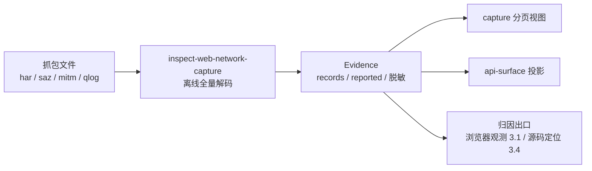

import { Meta } from '@storybook/addon-docs/blocks';

<Meta id="web-network-captures" title="网站与浏览器/网络抓包" name="Docs" />

# 网络抓包

网络抓包课处理的是**已经落盘的流量文件**：HAR、Fiddler Everywhere 的 SAZ 会话包、mitmproxy 的原生 `.mitm`、aioquic 的 qlog。`rea inspect-web-network-capture` 把它们离线解码成一份自描述的 Evidence——不访问文件里记录的任何 URL，不启动浏览器，也不监听代理。每条请求保留生产者原样字段（`reported`）、精确字节事实（`binary_fields`）与数字字面量（`numeric_literals`），已知认证头与显式声明的敏感值被结构性排除；顶层 `runtime_attribution` 恒为 `"unknown"`：文件能证明"发出过哪些请求、长什么样"，不能证明"哪段代码发的"。本课依次回答四个问题：文件怎么导入、Evidence 能读出什么、一串请求怎么提炼成 API 面、归因到代码的边界与出口在哪。底层 TShark/PCAP 线缆级分析归数据包捕获一课，这里只管应用层抓包格式。



| 回查项 | 值 |
| --- | --- |
| 命令 | `rea inspect-web-network-capture <capturePath> <har\|mitmproxy\|saz\|qlog> [--record N ...] [--sensitive-value V ...] --json` |
| MCP 同源工具 | `inspect_web_network_capture`：`capture_path`、`format`、`record_ordinals`、`detail: "summary"` |
| `har` | 仅 HAR 1.2 剖面；无外部引擎，原文件不变 |
| `saz` | Fiddler Everywhere 原生会话包；无需安装 Fiddler；展开字节另限 32 MiB |
| `mitmproxy` | 仅 Linux；`REA_MITMDUMP_COMMAND` 指向调用方自备的 mitmdump 12.2.3 |
| `qlog` | aioquic 1.5.0 JSON qlog 0.3 剖面；QUIC 整数字段必须是 JSON 数 |
| 解码预算 | 32 MiB 输入 / 96 MiB 解码回包 / 64 层嵌套；HAR、SAZ、qlog 固定 192 MiB Node 堆；mitmproxy 另有 768 MiB 地址空间与 30 秒 CPU；命令统一 30 秒墙钟 |
| 选择记录 | `--record` 取零基生产者序数，可重复传；先全量解码再选择，越界与重复都是输入错误 |
| 归因语义 | `runtime_attribution` 恒为 `"unknown"`；不发明浏览器事务 ID、场景出处或执行归因 |
| 后续视图 | `api-surface`、`capture`、qlog facets 经 `inspect-analysis-view` 投影；`environment-manifest`、`environment-state` 已写入文档、当前发布版尚未包含 |

## 快速上手

本课随课分发三个真实可跑的抓包文件：`session.har` 是 notes-web 演示应用（浏览器观测一课的同一页面）7 条请求的 HAR，`session.saz` 是 2 条请求的最小 SAZ，`origin.qlog` 是 3 个事件的 QUIC 记录。一条命令导入 HAR：

```bash
cd cheatsheets/web-network-captures
rea inspect-web-network-capture "$PWD/session.har" har --json > inspect.json
jq -c '.normalized_result | {sha256: .artifact.sha256, bytes: .artifact.bytes, total_records, runtime_attribution, decoder: .decoder.id}' inspect.json
```

实测输出：

```json
{"sha256":"6cc3135f9bd37e09e52d966c835cba4a4194fdf860a8451da8ba77f1f44fe866","bytes":8468,"total_records":7,"runtime_attribution":"unknown","decoder":"har-schema/lossless-json"}
```

`artifact` 认定了你选的文件与内容摘要，`total_records` 给出记录总数，`runtime_attribution` 直接声明归因未知。列出全部请求：

```bash
jq -r '.normalized_result.records[] | [.ordinal, .reported.request.method, .reported.request.url, .reported.response.status] | @tsv' inspect.json
```

实测输出：

```text
0	GET	http://127.0.0.1:3000/	200
1	GET	http://127.0.0.1:3000/app.js	200
2	GET	http://127.0.0.1:3000/notes.json	200
3	GET	http://127.0.0.1:3000/api/notes?page=1	200
4	POST	http://127.0.0.1:3000/api/notes	201
5	GET	http://127.0.0.1:3000/api/notes/42	200
6	GET	http://127.0.0.1:3000/api/notes/57	200
```

全程没有任何网络活动——记录里的 URL 只是字节，不会被访问。最小闭环到此完成；后面各节把这个闭环拆开讲透。

## 导入一次抓包

命令模型是两个位置参数加两组可选声明：`capturePath` 必须是绝对路径的本地普通文件（拒绝符号链接与并发变更），`format` 选定解释剖面——同一个文件换格式就是换一套解码契约。可选 `--record` 从零基序数中选择记录（可重复），可选 `--sensitive-value` 把字面值声明为敏感。MCP 走同名工具 `inspect_web_network_capture`，参数一一对应：

```json
{
  "name": "inspect_web_network_capture",
  "arguments": {
    "capture_path": "/absolute/session.har",
    "format": "har",
    "record_ordinals": [2, 0]
  }
}
```

两条解码纪律先立住：**每个记录都先验证再选择**——选中一条不会隐藏文件里其他坏记录；**显式选择保持调用方顺序与原始序数**。实测选择与本课 fixture 的两个错误：

```bash
rea inspect-web-network-capture "$PWD/session.har" har --record 2 --record 0 --json | \
  jq -c '.normalized_result.records[] | {ordinal, pointer: .location.pointer}'
```

实测输出（顺序是调用方给的 `2, 0`，指针仍是原文件位置）：

```json
{"ordinal":2,"pointer":"/log/entries/2"}
{"ordinal":0,"pointer":"/log/entries/0"}
```

```bash
rea inspect-web-network-capture "$PWD/session.har" har --record 99 --json
rea inspect-web-network-capture "$PWD/session.har" har --record 2 --record 2 --json
```

实测输出（分别是越界与重复）：

```json
{"code":"invalid_request","category":"invalid_input","details":{"issues":[{"path":["record_ordinals"],"reason":"invalid_format","message":"Producer ordinal 99 is outside the retained capture (7 records)."}]}}
```

```json
{"code":"invalid_request","category":"invalid_input","details":{"issues":[{"path":["record_ordinals"],"reason":"invalid_format","message":"Each requested producer ordinal must occur once."}]}}
```

四种格式共享这套模型，差别在前提与读出的事实。

### HAR

HAR 是最常见的入口：Chrome DevTools、Playwright、Fiddler Everywhere（选中会话后 Export 选择 HTTPArchive，确认 `log.version` 是 `"1.2"`）都能导出。REA 只支持 HAR 1.2 剖面，用未改动的 `har-schema@2.0.0` 校验，数字经 lossless-json 保留原始字面量。三个直接可查的行为：

- **未知扩展字段原样保留**。浏览器导出的 HAR 常带 `_initiator` 之类的私有扩展，它们按普通成员进入 `reported`。实测 fixture 第 2 条记录（notes.json 请求）：

```bash
jq -c '.normalized_result.records[2].reported.request | {url, initiator: ._initiator}' inspect.json
```

实测输出：

```json
{"url":"http://127.0.0.1:3000/notes.json","initiator":{"type":"script","stack":{"callFrames":[{"functionName":"","url":"http://127.0.0.1:3000/app.js","lineNumber":2,"columnNumber":10}]}}}
```

- **已知生产者剖面的怪癖被显式保留**：mitmproxy 的 `SaveHar` 对缺失请求体报 `postData.text: null`，REA 保留这个 null 而不伪造空串；Playwright 1.58.2 可能给出带方括号的 IPv6 `serverIPAddress`，报告层保留原拼写。生产者声明不认证来源。
- **重复对象键在物化前被拒绝**，`__proto__` 这类原型名按普通自有成员保留，不做原型污染。

### SAZ

Fiddler Everywhere 的 Session Archive Zip 是一个 ZIP：`raw/<id>_c.txt` 存原始请求字节、`_s.txt` 存原始响应字节、`_m.xml` 存元数据，REA 按文件名主干配对成一条记录。零基序数按每个会话在 ZIP 目录序中的**第一个成员**排，不看数字 ID 也不看捕获时间。直接检查原生 SAZ，不用装 Fiddler、不用转 HAR：

```bash
rea inspect-web-network-capture "$PWD/session.saz" saz --json > inspect-saz.json
jq -c '.normalized_result.records[0] | {ordinal, location, session_id: .reported.session_id, status: .reported.response.status}' inspect-saz.json
```

实测输出：

```json
{"ordinal":0,"location":{"kind":"archive-members","members":["raw/0001_c.txt","raw/0001_s.txt","raw/0001_m.xml"]},"session_id":"0001","status":"200"}
```

SAZ 的价值是字节保真：请求与响应保持原样存储，**不 dechunk、不解压**，头部的原始空格都原样保留（实测 `Host` 的值是 `" 127.0.0.1:3000"`，带前导空格）；响应状态是原始字符串 `"200"` 而非数字；体字节带独立的 `bytes`、SHA-256 与 base64 副证：

```bash
jq -c '.normalized_result.records[0].binary_fields[] | {pointer, bytes, sha256}' inspect-saz.json
```

实测输出：

```json
{"pointer":"/request/body","bytes":0,"sha256":"e3b0c44298fc1c149afbf4c8996fb92427ae41e4649b934ca495991b7852b855"}
{"pointer":"/response/body","bytes":17,"sha256":"cf73ab78b4124d723e3171cc43603306339f58136ffb1ae73fbcb1e97c7dd515"}
```

边界：展开后的归档内容限 32 MiB（超出在 `capture_path` 上报 `out_of_range`，附 `maximum_expanded_capture_bytes`）；加密归档与不认识的会话成员不支持；缺失成员保持 `null`，与空体是两回事；`_w.txt`、`_g.txt` 里的 WebSocket 与 gRPC 消息字节按不透明字节保留。

### mitmproxy

原生 `.mitm` 解码走调用方自备的 mitmdump：仅 Linux，且要求 mitmdump 12.2.3 的绝对路径，REA 不替你安装。解码用上游原样的 tnetstring 解码器，不跑 `FlowReader` 迁移、不转换成 HAR，原始 ID、状态版本、备份状态与未知扩展都原样保留，其他工具版本会得到显式的不支持剖面诊断：

```bash
REA_MITMDUMP_COMMAND=/absolute/mitmdump \
  rea inspect-web-network-capture /absolute/session.mitm mitmproxy --json
```

非 Linux 主机直接被拒。实测 macOS：

```json
{"code":"capability_unavailable","category":"unsupported_provider","message":"Native capture decoding requires Linux and an absolute REA_MITMDUMP_COMMAND path to caller-supplied mitmdump 12.2.3; HAR needs no external engine."}
```

在 macOS 上要么换 Linux 环境（官方仓库另有验证真实 HTTP/3 捕获的实验房文档），要么用生产者导出 HAR 检查。真实的 mitmproxy 消息是上游装配后的消息，不是线缆分片。

### qlog

qlog 是 QUIC 连接的事件记录，本课只认 aioquic 1.5.0 写出的 JSON qlog 0.3 剖面（`qlog_format: "JSON"`、`qlog_version: "0.3"`）；JSON-SEQ、JSONL 与列式事件不支持。每个事件有全局序数和原 `/traces/T/events/E` 指针，序数是遍历顺序、不是全局时间排序。手写 fixture 时最易踩的坑：QUIC 整数字段必须是 JSON 数，加引号会整体失败——实测报 `qlog QUIC integer must be a JSON number.`，且一个坏字段拒绝整个文件（无部分成功）：

```bash
rea inspect-web-network-capture "$PWD/origin.qlog" qlog --json > inspect-qlog.json
jq -c '.normalized_result.qlog | {profile, body_bytes, stream: .traces[0].streams[0] | {stream_id, unique_bytes, frame_length_sum, repeated_bytes, reported_final_sizes}}' inspect-qlog.json
```

实测输出：

```json
{"profile":"aioquic-1.5.0-json-0.3","body_bytes":"not-reported","stream":{"stream_id":"0","unique_bytes":"11","frame_length_sum":"11","repeated_bytes":"0","reported_final_sizes":["11"]}}
```

读 qlog 事实的三条边界：`recovery:packet_lost` 是端点自报，不证明真实网络丢包；`unique_bytes` 是区间并集、`frame_length_sum` 含重叠、`repeated_bytes` 是两者之差，重叠本身不证明重传；HTTP 体一律 `body_bytes: "not-reported"`，只有长度与头部元数据。控制流与 QPACK 流也计入流清单，所以流数不等于请求数。对大文件不必重复解码：先用 `inspect_web_network_capture` 带 `detail: "summary"` 留存证据，再经 `inspect_analysis_view` 按 facet 分页——`traces`、`streams`、`contributions`、`ranges`、`final-sizes`、`loss-declarations`、`incomplete-records`，默认 offset 0、每页 64 行，后三类只需 `trace_index`。

## 读懂抓包 Evidence

`normalized_result` 的顶层分八块：`artifact`（选中的文件与 SHA-256）、`format`、`decoder`（解码器标识与版本）、`total_records`、`records`、`container`、`limitations`、`runtime_attribution`。`container` 是容器元数据：HAR 的 `log.entries` 被替换为 `null`、`records_pointer` 指向记录集合（`/log/entries`）——这是检查表示，不是一份重建的 HAR 文件。`limitations` 逐字陈述边界，其中一条就是归因语义：

> This is retained producer evidence, without live browser transaction IDs, scenario provenance, execution attribution or deployment authenticity. Recorded URLs are never fetched.

每条记录五件套：`ordinal`（原始生产者序数）、`location`（HAR/qlog 是 `json-pointer`，SAZ 是 `archive-members`）、`reported`（生产者原样字段）、`binary_fields`（暴露字节的字节事实）、`numeric_literals`（数字字面量）。`numeric_literals` 解决 JS 数字精度陷阱：大整数与非有限数以字面字符串保留；标准 HAR 数字字段出现不安全数值会未过校验，扩展字段的数字仍可从副证读出。

### 大文件：摘要与分页

真实站点的 HAR 轻松几百兆，整包 `complete` 输出会撞 MCP 响应预算。分两条路：

- **MCP 探索**：`inspect_web_network_capture` 带 `detail: "summary"`（CLI 无此参数；CLI 与默认检查等价于 `detail: "complete"`），返回身份与计数，并把完整 Evidence 留存会话；拿 `normalized_result.parent_evidence_id` 当 `retained-evidence` 源，用 `inspect_analysis_view` 分页：

```json
{
  "source": { "kind": "retained-evidence", "evidence_id": "ev_..." },
  "view": { "kind": "capture", "detail": "preview", "offset": 0, "limit": 20 }
}
```

- **CLI 投影**：保存完整检查 JSON，把它作为 inline Evidence 传给 `inspect-analysis-view`，同一套 capture 页契约。实测 preview 页只剩标题字段（方法、URL、状态），省略头部与载荷：

```bash
jq -c '{source: {kind: "inline", evidence: .}, view: {kind: "capture", detail: "preview", offset: 0, limit: 3}}' inspect.json > capture-request.json
rea inspect-analysis-view capture-request.json --json > capture-page.json
jq -c '.normalized_result.items[0]' capture-page.json
```

实测输出：

```json
{"ordinal":0,"location":{"kind":"json-pointer","pointer":"/log/entries/0"},"reported":{"time":3,"startedDateTime":"2026-10-20T08:00:00.000Z","request":{"method":"GET","url":"http://127.0.0.1:3000/","httpVersion":"http/1.1"},"response":{"httpVersion":"http/1.1","status":200,"statusText":"OK"}},"binary_fields":[],"numeric_literals":[],"redactions":[]}
```

视图不重开文件、不重跑解码：文件被移动或修改后，视图仍是历史快照，要观察新字节就重新 inspect。`total_records` 计原始抓包总数，留存父级里的 `retained_records` 与页覆盖分开计——一页耗尽不证明未选记录里没有。

### 标注敏感值

抓包天然携带凭据。除默认的结构性排除（认证与 cookie 头、URL userinfo）外，显式声明让任意字面值整体退场：CLI 重复传 `--sensitive-value`，MCP 传 `sensitive_values`。声明本身不持久化进 Evidence，只保留计数；匹配的文本/UTF-8 字节字段整个置 `null`，不用替换标记——防止标记本身把敏感值带回来。实测声明 `created by demo`：

```bash
rea inspect-web-network-capture "$PWD/session.har" har --sensitive-value 'created by demo' --json | \
  jq -c '.normalized_result.records[4] | {content: .reported.response.content, redactions}'
```

实测输出（请求体与响应体同时命中，双双退场）：

```json
{"content":{"size":51,"mimeType":"application/json","text":null},"redactions":[{"pointer":"/request/postData/text","reason":"explicit-sensitive-value"},{"pointer":"/response/content/text","reason":"explicit-sensitive-value"}]}
```

一个顺序陷阱：声明过敏感值的父级会被 `api-surface` 等投影视图类型化拒绝（实测 `unsupported_target`，原因 `sensitive_values_unretained`）——视图写出的路径模板与限制文本无法回头核对未留存的声明。取舍见最佳实践。

## 提炼 API 面

`api-surface` 视图把记录列表折叠成 API 面：按方法、WHATWG URL origin 与路径模板分组，组内引用原记录序数、去重状态码与 MIME 类型。CLI 的请求文件用 jq 组装——实测当前发布版只接受 `retained-evidence` 与 `inline` 两种源；文档另定义了免 inline 计费的 `evidence-file` 源，当前发布版尚未包含：

```bash
jq -c '{source: {kind: "inline", evidence: .}, view: {kind: "api-surface", offset: 0, limit: 50, include_query_parameter_names: true}}' inspect.json > api-request.json
rea inspect-analysis-view api-request.json --json > api-surface.json
jq -c '.normalized_result.groups[] | {method, path_template, record_ordinals, statuses, query_names: [.query_parameter_names[].name]}' api-surface.json
```

实测输出（fixture 第 5、6 条被折叠进同一个模板）：

```json
{"method":"GET","path_template":"/","record_ordinals":[0],"statuses":[200],"query_names":[]}
{"method":"GET","path_template":"/api/notes","record_ordinals":[3],"statuses":[200],"query_names":["page"]}
{"method":"POST","path_template":"/api/notes","record_ordinals":[4],"statuses":[201],"query_names":[]}
{"method":"GET","path_template":"/api/notes/{numeric}","record_ordinals":[5,6],"statuses":[200],"query_names":[]}
{"method":"GET","path_template":"/app.js","record_ordinals":[1],"statuses":[200],"query_names":[]}
{"method":"GET","path_template":"/notes.json","record_ordinals":[2],"statuses":[200],"query_names":[]}
```

模板化段带依据与观测值，可核对：

```json
{"segment_index":2,"rule":"numeric","basis":"inferred","observed_values":["42","57"]}
```

模板规则按表序应用到仍编码的请求路径（点段移除之前），段序号从首斜杠后从零计：

| 规则 | 精确段格式 | 占位符 |
| --- | --- | --- |
| `numeric` | 仅 ASCII 数字 | `{numeric}` |
| `uuid` | RFC 9562 文本 UUID，任意版本，大小写不敏感 | `{uuid}` |
| `hex` | 至少 32 个十六进制位 | `{hex}` |
| `iso-date` | 合法日历日期 `YYYY-MM-DD` | `{iso-date}` |

`include_query_parameter_names: true` 时每组附去重查询名（URLSearchParams 语义：`+` 是空格、`%2B` 是 `+`）；默认不产该字段。三条边界：视图不推 handler 身份、schema 或因果关系（限制原文 "Grouping does not establish handler identity, URL-space schemas or causality."）；原生 mitmproxy、SAZ、qlog 父级返回类型化不支持错误；查询值、片段、凭据、头与体不进分组。更进一步的 `environment-manifest`（把主 origin 的请求折叠成可回放工具面）与 `environment-state`（提取读取观察到的初始状态）已写入官方文档、链向代理环境一课——但当前发布版（实测 6.7.0）的 `view.kind` 枚举还没有它们，报错会列出实际支持的 kinds，升级后以 `--schema` 为准。

## 请求归因到代码

这是本课最重要的边界。抓包 Evidence 的 `runtime_attribution` 恒为 `"unknown"`，限制文本明说没有 execution attribution——**历史抓包不证明哪段代码发了请求**。抓包里最接近的线索只有生产者自报的扩展字段（如 HAR 的 `_initiator` 栈），而"生产者声明不认证来源"是官方文档的原话。

真正的归因链在另两课：

- **运行时归因**走浏览器观测一课：`inspect-web-page` 的网络事件保留 initiator 栈位置（发出请求时的 JS 调用栈与源位置），这是"请求由谁发起"的运行时证据。
- **源码归因**走源码定位与导出一课：`export-web-scripts` 导出脚本清单，`trace-web-source-location` 经显式配对的 source map 把生成位置映射回原始源码，`analyze-web-bundle` 给出 chunk 边界与端点候选。

配合方式：api-surface 告诉你"有哪些端点、哪些记录共用一个模板"，把模板里的记录序数带回 3.1 的观测窗口或 3.4 的脚本定位，才落到代码。线缆级的另一条路——TShark 分析 PCAP、按四元组与 TLS 指纹关联进程——归数据包捕获一课，与本课的"应用层已装配消息"互补而非重叠。

## 最佳实践

- **原生格式优先，HAR 只作兼容。** SAZ/mitm 原样保留字节与生产者事实，转 HAR 是有损选择（重压缩、重新装配）。需要可视化时用 Fiddler Everywhere 的 Import Snapshot 原生检查，或导出 HAR 后保留原 SAZ 作出处。
- **需要 api-surface 就别先声明敏感值。** 声明过 `sensitive_values` 的父级会被投影视图类型化拒绝。顺序：先在干净证据上跑投影，需要外发时另起一次带 `--sensitive-value` 的检查——两次检查互不影响，原文件都不变。
- **`--record` 不是性能手段。** 选择发生在完整解码之后，撞堆预算时缩小文件才有用：让生产者导出小子集，或大文件经 MCP 走文档定义的 `evidence-file` 源；`NODE_OPTIONS` 抬不了固定 192 MiB 堆。
- **归因问题别用抓包硬答。** `runtime_attribution: "unknown"` 是设计语义。要代码位置，把记录序数带进浏览器观测的 initiator 栈，或用源码定位与导出对 source map。
- **复查带原件。** Evidence 是文件的历史快照，视图在文件消失后仍可分页，但要观察新字节必须重新 inspect 原文件——保留原件并对比 `artifact.sha256`。

## 常见问题

- `--record` 报 `Producer ordinal 99 is outside the retained capture (7 records).` 或 `Each requested producer ordinal must occur once.`？
  分别是越界与重复，都是输入错误、无部分成功。序数是零基生产者序数，先跑一次不带 `--record` 的完整检查看 `total_records` 再选。
- macOS 等非 Linux 主机上 mitmproxy 格式报 `capability_unavailable`？
  原生 `.mitm` 解码仅支持 Linux 加调用方自备的 mitmdump 12.2.3（`REA_MITMDUMP_COMMAND` 绝对路径）。要么换 Linux 环境（见参考资料中的 HTTP/3 实验房文档），要么让生产者导出 HAR 后用 `har` 格式检查。
- qlog 报 `qlog QUIC integer must be a JSON number.`？
  手写或工具生成的 qlog 把 QUIC 整数字段写成了字符串。去掉引号（`"stream_id": "0"` 改 `"stream_id": 0`）；qlog 校验是整文件的，一个坏字段拒绝全部。
- SAZ 检查报 `out_of_range`，带 `maximum_expanded_capture_bytes`？
  归档展开后超过 32 MiB。选择记录不绕过整体准入检查，也不能只解一半——用 Fiddler 重新导出小子集，或改用 HAR。
- 大 HAR 报 `resource_constraint`？
  撞了固定 192 MiB 解码堆（32 MiB 输入 / 96 MiB 回包预算同样适用）。重试与重复工作不解约束；换生产者导出的小抓包，或经 MCP 用 `evidence-file` 源避免 inline 信封计费（该源当前发布版尚未包含）。
- `api-surface` 报 `unsupported_target`、原因 `sensitive_values_unretained`？
  父级检查时声明过 `--sensitive-value`，视图无法核对其未留存的声明。换未声明的父级做投影，或按最佳实践调整顺序。
- `view.kind: "environment-manifest"` 报 `invalid_value`？
  当前发布版尚未包含该视图（文档已定、链向代理环境一课）。以报错里列出的 kinds 或 `rea inspect-analysis-view --schema` 为准，升级后再用。

## 总结回顾

摘要：

`inspect-web-network-capture` 把 HAR、SAZ、mitmproxy 与 qlog 抓包文件离线解码成自描述 Evidence：命令是"绝对路径加格式"两个位置参数，`--record` 按零基序数选择（全量解码后保持调用方顺序），`--sensitive-value` 把匹配字面值的字段整体置空并记录指针。Evidence 顶层是 `artifact`、`format`、`decoder`、`total_records`、`records`、`container`、`limitations` 与恒为 `"unknown"` 的 `runtime_attribution`；每条记录由 `ordinal`、`location`、`reported`、`binary_fields`、`numeric_literals` 与 `redactions` 组成。大文件走 MCP `detail: "summary"` 留存加 `capture` 分页，或 CLI 保存后 inline 投影；`api-surface` 把请求折叠成带模板依据的 API 面。归因不在本课能力内：运行时 initiator 栈归浏览器观测，source map 归源码定位与导出，PCAP 线缆分析归数据包捕获。

一句话：

> 抓包文件证明"发出过哪些请求、原样是什么"，永远不证明"哪段代码发的"——导入是离线解码，读出靠 reported 与投影视图，归因要回到运行时观测与源码定位。

知识要点：

- 四种格式各自的入口与前提是什么？哪种在本机（macOS）不可用？
- `--record` 的序数从几开始？选择会跳过对其他记录的验证吗？
- `reported`、`binary_fields`、`numeric_literals` 各自保留什么？为什么 SAZ 的状态码是字符串？
- 大文件的两条读取路径分别怎么走？CLI 有 `detail: "summary"` 吗？
- `--sensitive-value` 声明后匹配字段变成什么？对后续 api-surface 投影有什么副作用？
- api-surface 的四条模板规则是什么？实测里 `/api/notes/42` 与 `/api/notes/57` 折叠成了什么？
- `runtime_attribution` 恒为什么值？把请求归因到代码的正确路径经过哪两课？
- HAR 的 `_initiator` 扩展字段在 Evidence 里处于什么地位？

## 参考资料

- [Historical web network captures（docs/web-network-captures.md）](https://github.com/morluto/rea/blob/main/docs/web-network-captures.md)
  本课一手来源：`inspect-web-network-capture` 契约、四种格式剖面、Evidence 结构、敏感值脱敏、api-surface 与 environment 视图、资源预算。
- [Website observation with CDP（docs/browser-observation.md）](https://github.com/morluto/rea/blob/main/docs/browser-observation.md)
  归因出口之一：`inspect-web-page` 网络事件保留 initiator 栈位置，是请求运行时归因的证据来源。
- [Captured website source locations（docs/web-source-location.md）](https://github.com/morluto/rea/blob/main/docs/web-source-location.md)
  归因出口之二：`trace-web-source-location` 的源映射定位与显式配对前提，源码定位与导出一课的入口。
- [REA CLI 文档（docs/cli.md）](https://github.com/morluto/rea/blob/main/docs/cli.md)
  CLI 保存 Evidence 并以 inline source 投影 `inspect-analysis-view` 视图的请求文件模式。
- [Verify real HTTP/3 MITM captures（docs/http3-capture-lab.md）](https://github.com/morluto/rea/blob/main/docs/http3-capture-lab.md)
  在 Linux 一次性客户机里验证真实 mitmproxy HTTP/3 捕获的实验房流程，mitmproxy 原生解码的进阶入口。
- [MCP contracts（docs/mcp-contracts.md）](https://github.com/morluto/rea/blob/main/docs/mcp-contracts.md)
  `inspect_web_network_capture` 与 `inspect_analysis_view` 的 MCP 契约，含 `environment-manifest`、`environment-state` 视图的文档定义。
