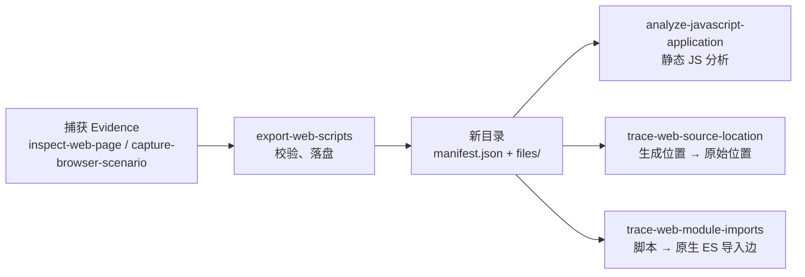

import { Meta } from '@storybook/addon-docs/blocks';

<Meta id="web-source-tracing" title="网站与浏览器/源码定位与导出" name="Docs" />

# 源码定位与导出

源码定位与导出是一条**全程离线**的流水线：把捕获（浏览器观测、场景捕获的产物）里保留的网站脚本落成"脚本字节 + 校验过的 manifest"的本地目录，再在它之上回答两个独立的源码问题——`rea export-web-scripts` 负责导出，`rea trace-web-source-location` 借一份显式配对的本地 source map 把压缩产物中的一个生成位置映射回原始源码位置，`rea trace-web-module-imports` 追踪一个脚本的外向原生 ES 导入边。三个操作都不抓取 URL、不执行应用代码；它们给出的证据是"派生自这份捕获与显式配对的本地输入"，不是"网站全貌"，也不证明执行、部署真实性或 UI 因果。主线判断一句话：捕获是唯一的源头，导出是唯一的桥，map 配对与导入上下文由调用者负责——REA 只做有边界的离线派生。



| 回查项 | 值 |
| --- | --- |
| 导出脚本 | `rea export-web-scripts CAPTURE_JSON NEW_DIR --json` |
| 静态分析导出产物 | `rea analyze-javascript-application NEW_DIR/files --json` |
| 定位源码位置 | `rea trace-web-source-location MANIFEST SCRIPT_INDEX MAP_PATH MAP_URL LINE COLUMN --json` |
| 追踪模块导入 | `REA_BROWSER_EXECUTABLE=/path/to/chrome rea trace-web-module-imports MANIFEST SCRIPT_INDEX --json` |
| MCP 同源工具 | `export_web_scripts` / `trace_web_source_location` / `trace_web_module_imports` |
| 捕获要带脚本字节 | 被动观测选 `include_script_sources: true`（CLI `--include-script-sources`）；场景捕获把 `capture.network.response_body` 选 `true` |
| 通用尺寸边界 | manifest 32 MiB、选中脚本 16 MiB；导出不抓 URL、不执行 JavaScript |
| source map 预算（定位） | map 4 MiB、codec 回复 32 MiB、262144 解码行/段、64 层嵌套 section；解码期限 20 秒；外部 section URL 报 `unsupported-profile` |
| 模块追踪前提 | 自备支持 `import.meta.resolve` 的 Chromium；原生解析期限 20 秒；import map 4 MiB；无字面量导入不启动浏览器 |

## 快速上手

先有一份带脚本字节的捕获。沿用浏览器观测一课的演示页，被动观测加 `--include-script-sources`，把 Evidence 记录存成 UTF-8 JSON：

```bash
rea inspect-web-page http://127.0.0.1:9222 TARGET_ID \
  --observation-ms 1000 --include-script-sources --json > /analysis/capture.json
```

场景捕获走另一条：在场景契约里把 `capture.network.response_body` 选为 `true`（契约见场景捕获一课）。两类捕获对导出等价——导出只要求一个普通文件：指向普通文件的 symlink 接受，目录、命名管道与设备文件在读捕获字节、建输出之前就被拒绝。

导出。目的地必须是一个**不存在**的目录，每次捕获建一个新目录：

```bash
rea export-web-scripts /analysis/capture.json /analysis/exported-scripts --json
```

结果是一个私有权限的新目录：`manifest.json` 保存每个来源的 URL、身份与校验过的摘要；脚本字节在 `files/` 下按 origin 分目录，无歧义时保留相对模块布局。MCP 调用的内联结果带 `analysis_input`，可直接传给静态分析器；CLI 直接把 `files/` 交给 JavaScript 静态分析一课的命令：

```bash
rea analyze-javascript-application /analysis/exported-scripts/files --json
```

最小闭环到此完成：浏览器里的脚本变成了本地分析器可解析的工件。没有可导出脚本字节时 `analysis_input` 为 `null`，manifest 保留不可用来源及原因——按来源类型补内容选项重新捕获（见常见问题）。两个源码问题接着在这份导出上回答：压缩产物里某一行原来是哪一行，用定位源码位置；这个脚本依赖哪些模块，用追踪模块导入。

## 导出脚本

`export_web_scripts` 把保留的浏览器来源桥接进现有本地 JavaScript 分析器，CLI 与 MCP 用同一工作流：读取一份已保存的 `inspect_web_page` 或 `capture_browser_scenario` 捕获，把脚本与校验过的 manifest 写进调用者指定的一个不存在目录。导出不抓取 URL、不执行 JavaScript——它只派生自捕获里已经保留的字节，保留的 Debugger 源与响应字节不构成执行证明，也不等于完整网站。

### 捕获前提

捕获是导出的唯一输入：一份已保存的捕获结果，存成完整 Evidence 记录或其规范化结果，UTF-8 JSON——MCP 的 `structuredContent` 本身就是完整 Evidence 记录。脚本字节不会在导出时补抓，捕获时就要选对内容：

- 被动观测选 `include_script_sources: true`（CLI `--include-script-sources`）；
- 场景捕获把 `capture.network.response_body` 选 `true`。

输入文件必须是普通文件，Evidence 信封必须有有效语义标识符且操作匹配。选错内容选项不会报错——导出照常成功，只是没有可导出的脚本字节，`analysis_input` 为 `null`。

### 目录规则与输出布局

```bash
rea export-web-scripts /analysis/capture.json /analysis/exported-scripts --json
```

目的地必须是**不存在**的目录：已存在的目录或 symlink 被整体拒绝，不会覆盖其中内容。REA 以私有权限创建输出，对每个写入文件做 digest 校验与持久化回读，失败或取消时移除自己的部分输出；回滚失败会报告残留路径。MCP 用 `capture_path` 与 `output_directory` 两个绝对路径参数表达同一选择。

落盘布局三条规则：

- `manifest.json` 保存与内联结果相同的 manifest 字段（不含它自身的描述符），不重复脚本字节；`relative_path` 相对于 `analysis_input.input_path`。
- 无查询串的普通 `.js`、`.mjs`、`.cjs` URL 路径按 origin 分目录，无歧义时保留相对模块布局。
- 竞争版本、query/fragment 变体、大小写与文件/目录前缀冲突、内联来源、不可表示路径，一律用唯一隔离名并附原因；连缺失的竞争来源都会阻止选择看似规范的版本——隔离是为了不让本地分析器选中与观察版本不同的字节。

### 来源身份与效力边界

每个来源内联返回，带 URL 和 script/frame 身份或 request transaction 与事件序列引用；结果还含输入捕获的字节 digest、原始覆盖信息、来源 Evidence 链接（如有）与持久化 manifest 的 digest 和字节数。两类来源的身份效力不同：

- **被动来源**是 Debugger 暴露的文本，按 UTF-8 编码，保留校验过的 digest 与 source-map 声明；不可用或明确非 JavaScript 的来源保持不可用。
- **场景来源**是被分类为 `script` 的观察请求，关联一个响应事件，字节来自 Playwright 的 `Response.body()`；URL 永远不参与选择响应。CDP 拿不到响应体时 Playwright 可能带凭据重新加载该 URL——所以 transaction 与事件引用不能证明导出字节来自原始网络事务，捕获与导出 manifest 都保留这一限制。二进制与空字节按原样写入。

效力边界还有三条：声明的 redaction 被保留且可能改变 JavaScript 语法，被动捕获不报告字节级 redaction 标志（该值保持未知）；下游分析器解析的是实际导出文件，能解析普通捕获的相对模块，但不支持浏览器 import maps、根相对 URL 加载、远程导入与运行时行为，本地 resolver 可能剥离 import 查询/fragment，缺失依赖保持未知；source maps 在导出时不抓取也不重建。Evidence 身份上，导出 Evidence 描述对捕获的派生，后续应用分析 Evidence 描述本地导出工件，两者身份与权限分离。

## 定位源码位置

`trace_web_source_location` 把导出脚本中的一个选定位置，通过一份显式配对的本地 source map 映射回原始位置：工作流校验 manifest、脚本与 map 的实际字节身份，内联返回原始位置与嵌入源。它不获取浏览器、不抓取 URL、不执行应用代码。

### 选择脚本与 source map

```bash
rea trace-web-source-location \
  /analysis/scripts/manifest.json 0 \
  /analysis/app.js.map 'https://example.test/maps/app.js.map?v=7#context' \
  1 25 --json
```

六个位置参数依次是：manifest 路径、零基脚本索引、绝对 map 路径、绝对 map URL 上下文、一基生成行号、零基 UTF-16 列号。MCP 用同名结构表达同一选择：

```json
{
  "manifest_path": "/analysis/scripts/manifest.json",
  "script_index": 0,
  "source_map": {
    "path": "/analysis/app.js.map",
    "url": "https://example.test/maps/app.js.map?v=7#context"
  },
  "generated_position": { "line": 1, "column": 25 }
}
```

map URL 只为解析 `sources` 与 `sourceRoot` 提供上下文，不是抓取指令；绝对虚拟上下文或 file 上下文也可以。map 与脚本的配对由调用者选择：一份 source-map 声明或一份本地 map 都不证明部署真实性或执行。要查的是"这个脚本依赖谁"而不是"这一行来自哪"，用追踪模块导入。

### 读懂映射结果

- 查找规则：跨行找"小于等于选中点的最大生成位置"，返回该位置的**所有**段，包括 generated-only 映射；遵循 ECMA-426 GetOriginalPositions，REA 公开契约用一基行。
- 点结果不确立源范围覆盖、执行或 UI 因果。
- 映射条目保留原始源名与 sourceRoot、section 路径、section 内局部索引与扁平索引；重复 URL 保持独立（嵌入内容不同的条目也如此）；缺失源名的解析 URL 为 `null`；越出嵌入文本的坐标保留报告值、偏移为 `null`。
- 嵌入内容哈希是解码后 `sourcesContent` 字符串（含行尾）的 UTF-8 编码摘要，不代表独立捕获的原始文件。
- 原始 map 文本保留在 Evidence 的 `raw_result`，未知扩展名不作解释。

解码器与预算：适配器锁定上游 `@jridgewell/trace-mapping` 0.3.31 且不改其代码，解码前校验 map/VLQ 结构、嵌套 indexed 偏移与 section 边界；支持常规 map 与内联 indexed sections，外部 section URL 返回可操作的 `unsupported-profile` 错误。解码在自有 Node 子进程中完成，20 秒期限；完整证据受 4 MiB map、32 MiB codec 回复、262144 解码行/段、64 层嵌套 section 预算约束，叠加 32 MiB manifest 与 16 MiB 选中脚本边界——超预算显式失败，不给部分结果。Bun 运行时忽略 V8 堆标志并在 `runtime` 中记录；Windows 上以 Job Object 限制提交内存 704 MiB。

### 从运行时坐标换算

运行时归因给出的坐标是 CDP 口径：`observe-web-execution` 的调用点与覆盖计数、`inspect-web-event-listeners` 的回调坐标，都是 `url` 所指资源中的零基行与 UTF-16 列。`trace-web-source-location` 收的是一基、脚本相对的行与零基列。两条换算规则：

- 外部脚本（`url` 就是脚本文件）：`line = line_number + 1`，`column` 保持不变；`script_id` 为空的 initiator 位置落在脚本文件里时同样处理。
- 内联脚本（需要 `script_id` 与它的 `resource_start`）：`line = line_number - resource_start.line_number + 1`；仅当 `line_number === resource_start.line_number` 时 `column = column_number - resource_start.column_number`，后续行保持报告列。列始终零基。

换算要求源起点与列坐标已知；缺失的坐标保持 unknown，不要猜测。这两条命令本身的捕获面与边界归运行时归因文档，换算桥接关系见边界与相邻入口一节。

## 追踪模块导入

`trace_web_module_imports` 从导出的捕获里追踪一个脚本的外向原生 ES 导入与再导出：校验所选源的 SHA-256 与字节数，保留浏览器 URL 身份，内联返回所有匹配的捕获候选，不重新抓取网站资产。

### 自备浏览器与命令

```bash
REA_BROWSER_EXECUTABLE=/absolute/path/to/chrome \
  rea trace-web-module-imports /analysis/export/manifest.json 0 \
  --importer-url 'https://example.test/app/main.js?build=2#entry' \
  --import-map-path /analysis/import-map.json \
  --import-map-base-url https://example.test/maps/ \
  --json
```

浏览器前提由调用者满足：提供一个支持 `import.meta.resolve` 的 Chromium 可执行文件（`REA_BROWSER_EXECUTABLE`，绝对路径），REA 不安装也不升级浏览器；该功能的真实验证覆盖 Linux x64。主机需要时加 `REA_BROWSER_NO_SANDBOX=true` 传对应 Chromium 启动选项——它不是 REA 的安全边界。MCP 输入表达同样选择：

```json
{
  "manifest_path": "/analysis/export/manifest.json",
  "script_index": 0,
  "importer_url": "https://example.test/app/main.js?build=2#entry",
  "import_map": {
    "path": "/analysis/import-map.json",
    "base_url": "https://example.test/maps/"
  }
}
```

引擎形态决定了证据效力：自有临时浏览器上下文运行 REA 的可信 resolver stub，所选应用只作为数据解析、永不执行；页面请求由合成文档/stub 满足或被阻断，不下载网站资产——这也不是 OS 沙箱或浏览器级网络隔离。没有字面量导入的源根本不启动浏览器。预算：manifest 32 MiB、源 16 MiB、import map 4 MiB；原生解析一个 20 秒期限，清理可延长；取消只关闭自有浏览器，清理失败则不能返回成功追踪。

### 选择导入上下文

- `script_index` 在 `manifest.scripts` 里从零开始。
- 省略 `--importer-url` 时，追踪用上报的源 URL 做导入上下文；内联脚本无法仅凭该 URL 建立文档 base——已知时显式给上下文。
- `--import-map-path` 与 `--import-map-base-url` 可选，只读本地 JSON；map 字节与 base URL 被原样保留，但选中它不证明这份 map 曾安装在捕获的页面里。
- 初期支持无 userinfo 的 HTTP(S) 导入上下文。

### 读懂导入证据

- 静态导入、再导出与字面量动态导入得到原生引擎的解析 URL 或确切拒绝消息，空字符串原样保留；计算型动态导入保留表达式与源位置，标记 `computed-specifier` 未知解析；被擦除的 type-only 导入/导出与推断的打包器 ID 不算原生导入声明。
- 位置用 UTF-16 偏移与列、一基行；解析恢复诊断与不可解析输入都显式报告。
- 候选分级：与上报 URL 完全一致的是 `exact-reported-url` 候选；去掉 fragment 的响应 URL 是较弱的 `response-url-without-fragment` 内容候选。query 与 fragment 变体互不相同，多个捕获版本全部返回、不选 canonical——结论要绑定到具体候选，而不是"该 URL 的脚本"。
- 候选元数据只是上报的捕获证据，只有所选源的字节被重新校验；缺失或懒加载的目标可以解析成功但没有任何捕获候选。每条关系的 `execution` 都是 `unknown`。
- source map 声明仍只是声明：本操作不读取也不构造 map 字节、原始映射、worker 归属或 UI 因果。
- 所选源从 manifest 当前目录下的 `files/` 加载；目录迁移后，原始上报路径与实际当前路径分别保留。不安全路径、symlink 源目录、非常规文件、digest/大小不符、畸形 UTF-8 显式失败。

## 边界与相邻入口

三个能力各管一段，相邻问题各有入口：

| 相邻问题 | 入口 | 归属 |
| --- | --- | --- |
| 捕获怎么拿 | `list-browser-targets` + `inspect-web-page`（被动）、`capture-browser-scenario`（场景） | 浏览器观测、场景捕获两课 |
| 请求/响应体与 HAR/SAZ 抓包文件 | `inspect-web-network-capture` | 网络抓包一课 |
| bundle 结构：chunk 边、路由与端点候选、vendor 指纹 | `analyze-web-bundle`（不执行解析脚本构件，可选 source-map/原始源证据） | 捕获侧 bundle 解析，见官方 `docs/browser-observation.md` |
| 运行时坐标从哪来 | `observe-web-execution`（V8 精确覆盖）、`inspect-web-event-listeners`（节点监听器回调） | 运行时归因，见官方 `docs/web-runtime.md`；换算见本课定位小节 |
| 导出产物的应用图与工作流 | `analyze-javascript-application` | JavaScript 静态分析、应用图两课 |
| 导出 Evidence 包的导入导出与投影 | `export_evidence_bundle` 等 | Evidence 包管理一课 |

三个能力共同的"不做什么"：不抓取 URL、不执行应用代码、不证明执行或部署真实性；导出字节与原始网络事务的对应关系在场景来源上只保留为显式限制（见导出小节）。

## 最佳实践

- **一次捕获配一个全新导出目录。** 目的地必须不存在，复用目录既会被拒绝，也会混淆不同捕获的派生关系；目录名带上捕获来源与日期，回查时能直接对上 Evidence 链接。
- **先补内容选项再导出，不要拿空结果硬分析。** 被动观测与场景捕获的脚本字节是两个独立开关，导出不抓取——捕获里没有的字节不会凭空出现；`analysis_input` 为 `null` 时先看 manifest 里的不可用来源及原因。
- **map 配对与 URL 上下文由你负责。** 定位只验证 manifest、脚本与 map 的字节身份和解码结构，不验证"这份 map 就是这个脚本部署时的那份"；map URL 上下文写成脚本的真实来源地址，`sources` 与 `sourceRoot` 的相对解析才落对位置。
- **定位与追踪回答不同问题，别互相硬套。** "这一行原来是哪一行"用定位（需要显式配对的本地 map）；"这个脚本依赖谁"用追踪（不需要 map，但只覆盖字面量原生导入）。两者都不证明执行。
- **运行时坐标先进过换算再定位。** CDP 零基行到 REA 一基行的换算在外部脚本与内联脚本上规则不同；跳过换算会把位置整体错一行，内联脚本还会错列。

## 常见问题

- `rea export-web-scripts` 报目的地已存在或拒绝 symlink？
  正常。目的地必须是不存在的目录，已存在目录或 symlink 被整体拒绝且不覆盖内容；换一个新目录重跑，每次捕获用独立目录。
- 导出成功但 `analysis_input` 是 `null`，静态分析没东西可跑？
  捕获里没有脚本字节，而导出不会补抓。看 manifest 里的不可用来源及原因：被动观测补 `--include-script-sources` 重新捕获，场景捕获把 `capture.network.response_body` 选 `true` 重新捕获。
- `rea trace-web-module-imports` 提示要浏览器？
  模块追踪用真实 Chromium 的原生 `import.meta.resolve` 做解析：自己装好 Chrome 系浏览器，用 `REA_BROWSER_EXECUTABLE` 指向可执行文件的绝对路径；REA 不安装、不升级浏览器。主机需要时加 `REA_BROWSER_NO_SANDBOX=true`。
- 某个依赖"解析成功"却没有任何候选？
  缺失或懒加载目标：原生解析成功了，但捕获里没有它的字节。先让页面在捕获前真正加载过该模块，再捕获、导出、重跑追踪。每条关系的 `execution` 都是 `unknown`，解析结果不构成执行证明。
- 定位报 `unsupported-profile`？
  source map 用了外部 section URL。当前解码器只支持常规 map 与内联 indexed sections；换成 section 完整内联的本地 map 再试。
- 场景捕获导出的脚本字节和抓包文件里的响应对不上？
  场景来源的字节来自 Playwright 的 `Response.body()`；CDP 无响应体时 Playwright 可能带凭据重新加载该 URL，导出字节因此不保证来自原始网络事务——这是捕获与导出 manifest 都保留的显式限制。要字节级核对响应用网络抓包一课的离线分析。

## 总结回顾

摘要：

源码定位与导出把"页面上跑的脚本"变成"可查证的本地源码问题"。`export-web-scripts` 读取一份带脚本字节的捕获（被动观测的 `--include-script-sources` 或场景捕获的 `capture.network.response_body`），把脚本与校验过的 manifest 落进一个不存在的新目录：按 origin 分目录、冲突用带原因的隔离名、私有权限、digest 加持久化回读校验、失败回滚。在此之上，`trace-web-source-location` 用六个位置参数（manifest、脚本索引、map 路径、map URL 上下文、一基行、零基列）借显式配对的本地 source map 把生成位置映射回原始位置，并给出 CDP 坐标到 REA 契约的换算规则；`trace-web-module-imports` 用自备 Chromium 的原生解析器追踪一个脚本的外向 ES 导入，按 `exact-reported-url` 与 `response-url-without-fragment` 分级返回全部捕获候选。三个操作全程离线，每一步都只描述对捕获与显式输入的派生。

一句话：

> 捕获是唯一源头、导出是唯一桥梁：REA 把捕获中的脚本离线落盘，再用你配对的 map 和你提供的浏览器回答"这一行来自哪、这个脚本依赖谁"——每一步都只证明派生，不证明执行。

知识要点：

- 三个命令各自回答什么问题？输入分别是什么、从哪来？
- 被动观测与场景捕获分别要选哪个内容选项，导出才有脚本字节？
- 导出目录有哪些规则（存在性、权限、校验、回滚）？manifest 与 `files/` 如何组织？
- 冲突与变体在导出布局里如何命名？隔离为什么连"缺失的竞争来源"都要考虑？
- 定位命令的六个位置参数各是什么？map URL 上下文起什么作用、为什么不是抓取指令？
- 映射按什么规则选位置？点结果能证明什么、不能证明什么？
- CDP 坐标怎样换算成定位坐标？外部脚本与内联脚本的规则差在哪？
- 模块追踪为什么需要自备 Chromium？哪类源不会启动浏览器？
- `exact-reported-url` 与 `response-url-without-fragment` 两类候选效力差在哪？结论应绑定什么？
- 哪些结论三个操作都刻意不给出？

## 参考资料

- [Captured website scripts and static JavaScript analysis（docs/website-script-export.md）](https://github.com/morluto/rea/blob/main/docs/website-script-export.md)
  本课一手来源：`export_web_scripts` 契约、捕获内容选项、目录规则、来源身份与隔离命名、分析器支持边界。
- [Captured website source locations（docs/web-source-location.md）](https://github.com/morluto/rea/blob/main/docs/web-source-location.md)
  本课一手来源：`trace_web_source_location` 六参数契约、映射语义、解码器配置与预算边界。
- [Captured website module relationships（docs/website-module-trace.md）](https://github.com/morluto/rea/blob/main/docs/website-module-trace.md)
  本课一手来源：`trace_web_module_imports` 命令与浏览器前提、导入上下文选择、候选分级与证据效力。
- [Website runtime source attribution（docs/web-runtime.md）](https://github.com/morluto/rea/blob/main/docs/web-runtime.md)
  运行时坐标口径与换算规则的来源；`observe-web-execution`、`inspect-web-event-listeners` 的能力边界。
- [Website observation with CDP（docs/browser-observation.md）](https://github.com/morluto/rea/blob/main/docs/browser-observation.md)
  捕获侧 `--include-script-sources` 选项与 `analyze-web-bundle` 的能力边界。
